

# 5 in 5: Folding

*5 in 5: Folding* is a five-day rapid prototyping study. Each day, I created one experiment based on folding. Instead of developing one finished project, I used this short and intensive process to quickly test different ideas, materials, and mechanisms.

The five prototypes connect folding with generative art, architecture, transformable structures, logic gates, and everyday objects. Through these experiments, folding became more than a way to turn a flat surface into a three-dimensional form. It could also work as a rule, a spatial concept, a physical mechanism, a computational system, or a way to question how familiar objects should behave.

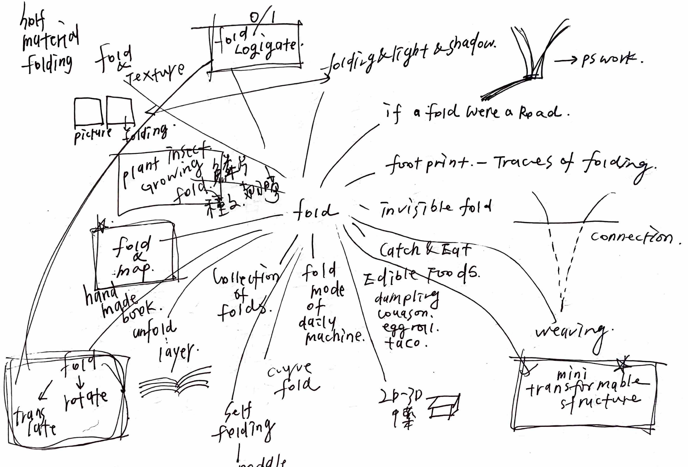

## Day 1 — “A” Folding

“A” Folding explores how physical paper folding can become a generative system. I began with a square sheet of paper and used a set of mathematical rules to control where and how it should fold. Linear algebra was used to calculate the folding process, while an evolution strategy searched for a folded form that looked like the letter A.

This experiment connects precise computation with unpredictable physical results. Although the system follows clear rules, the final forms can still become complex, irregular, and unexpected.

<ImageGrid
  columns={2}
  aspect="1 / 1"
  fit="contain"
  images={[
    {
      src: "/images/projects/5-in-5-folding/02-day1-paper-fold.png",
      alt: "A square sheet of white paper folded into a form resembling the letter A.",
      caption: "Physical paper-folding study",
    },
    {
      src: "/images/projects/5-in-5-folding/03-day1-evolution-results.png",
      alt: "Four generated folding results that resemble the letter A.",
      caption: "Forms found through the evolution strategy",
    },
  ]}
/>

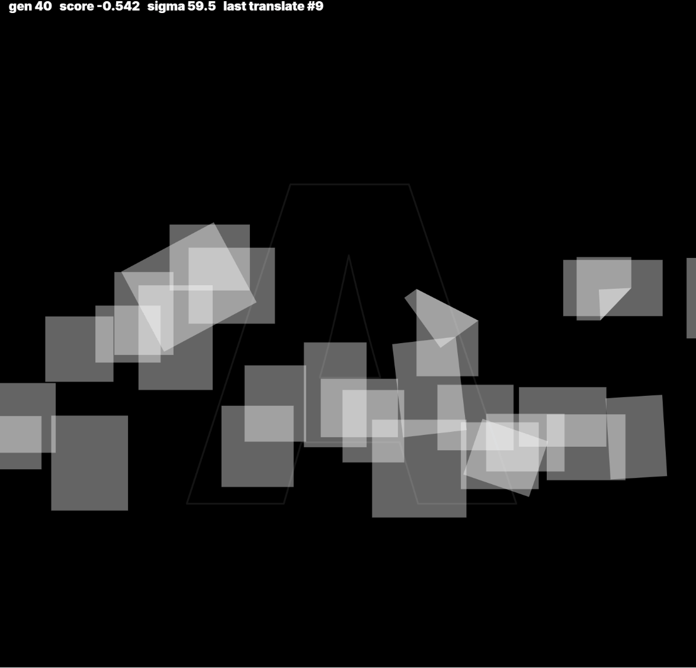

## Day 2 — Unfold the City

From the 5-in-5 exercise to the midterm, *Unfold the City* developed into three paper prototypes that use folding to compare different urban patterns and spatial experiences.

### The City of Growth

New York expands linearly from south to north through its grid, while Paris grows outward from a center through radial streets and connections.

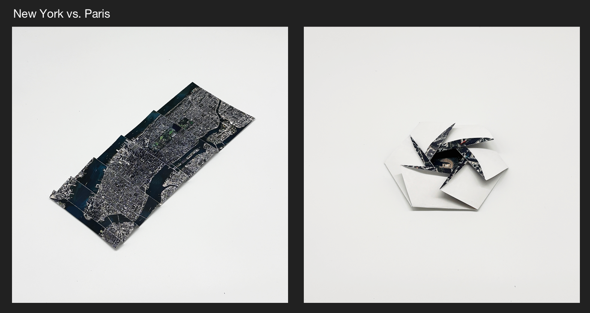

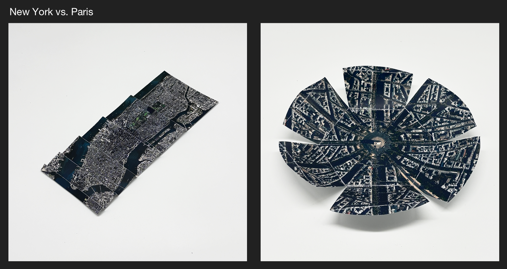

### The City of Order

The Greek theater opens toward its surrounding landscape, while the Roman Colosseum encloses the audience around a central space.

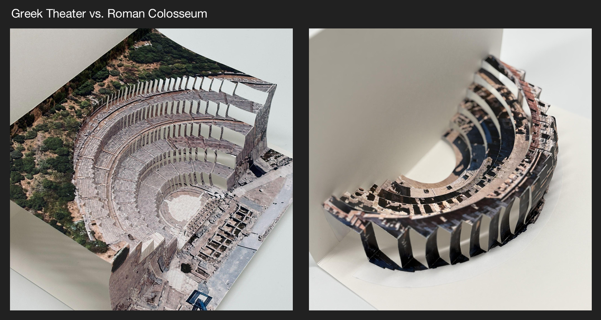

### The City of Perspective

At Piazza del Campo, the tower appears as a landmark when viewed from the square, but becomes a viewpoint when looking back at the city from above.

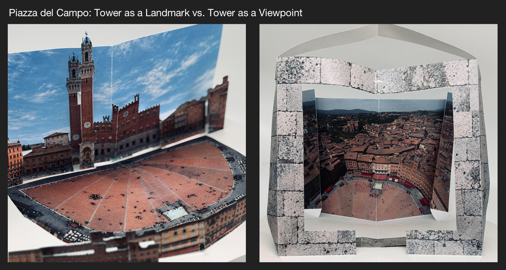

## Day 3 — Mini Transformable Structure

This prototype explores folding as a small transformable mechanism. The goal was to create a miniature bridge that could unfold and cross a narrow gap. The design was inspired by small wearable mechanisms and folded paper-tube structures.

The prototype did not move as smoothly as expected. Folding paper was relatively easy, but controlling its movement with a mechanism became difficult at this scale. This experiment helped reveal the difference between creating a foldable form and designing a reliable transformation.

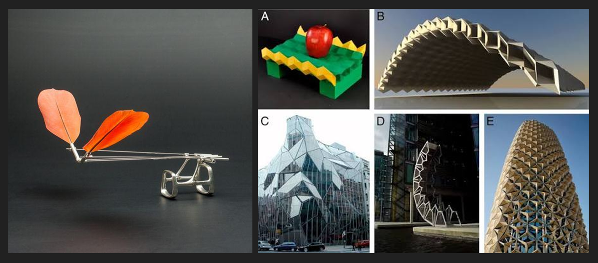

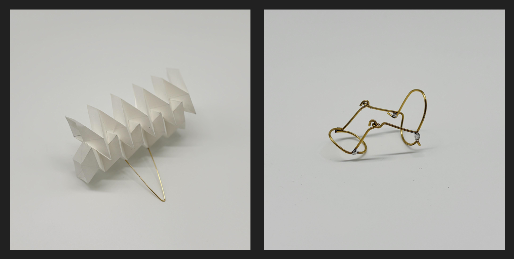

<video controls playsinline preload="metadata">
  <source src="/images/projects/5-in-5-folding/11-day3-transformable-structure.mp4" type="video/mp4" />
</video>

## Day 4 — Binary Fold

*Binary Fold* connects paper mechanisms with digital logic. The project begins with a simple relationship: a folded state can represent `0`, while an unfolded state can represent `1`.

Inspired by pop-up books, I tested whether multiple paper mechanisms could work as physical inputs. By combining them, the folded structure may behave like basic AND, OR, and NOT logic gates. The prototype is an early investigation into how computation could become physical, visible, and understandable through movement.

### NOT

<video controls playsinline preload="metadata">
  <source src="/images/projects/5-in-5-folding/12-day4-not-gate.mp4" type="video/mp4" />
</video>

### AND

<video controls playsinline preload="metadata">
  <source src="/images/projects/5-in-5-folding/13-day4-and-gate.mp4" type="video/mp4" />
</video>

### OR

<video controls playsinline preload="metadata">
  <source src="/images/projects/5-in-5-folding/14-day4-or-gate.mp4" type="video/mp4" />
</video>

## Day 5 — Afoldable

*Afoldable* imagines everyday objects that can fold even when their original materials are normally hard or solid. Objects such as a tomato, an Oreo, a coffee cup, and a button were reimagined as soft and foldable forms.

Rather than developing a practical folding technology, this experiment focuses on expectation. When a familiar object behaves in an unfamiliar way, it can appear strange, playful, or humorous. The project uses folding to question how material properties influence the way we understand everyday objects.

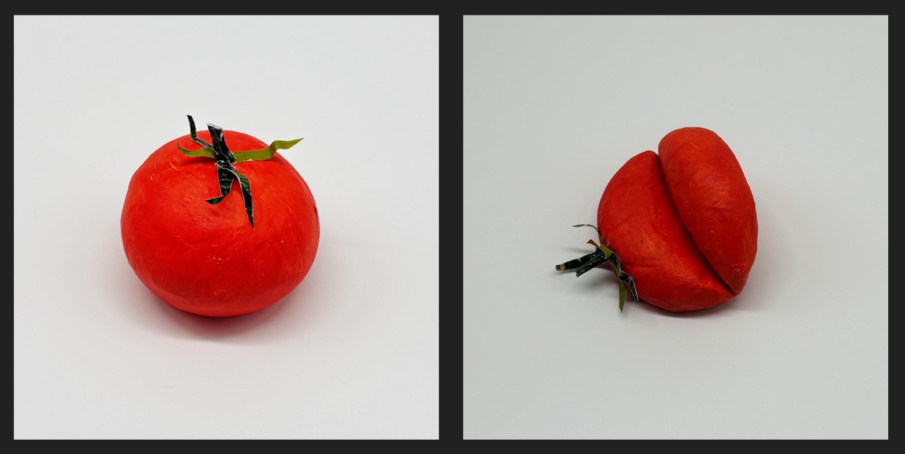

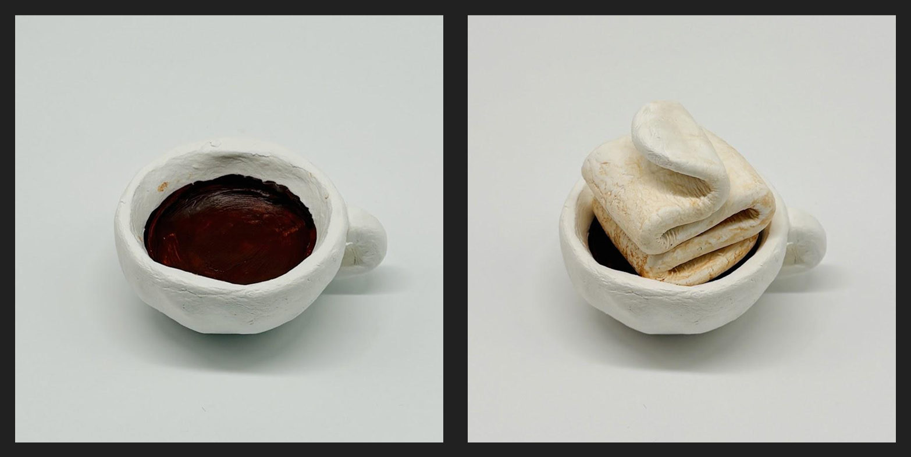

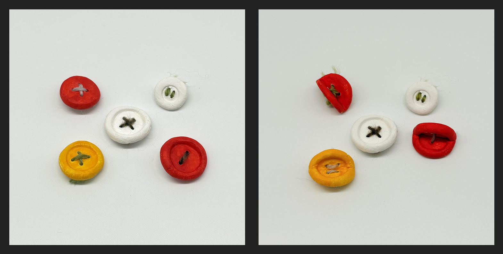

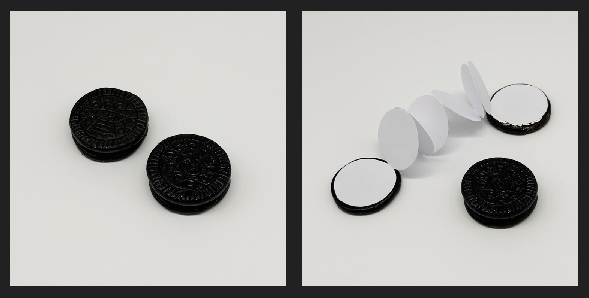

## Reflection

The five prototypes show how one simple action can lead to very different design questions. During the five-day process, folding changed from a physical technique into a broader method for thinking about rules, space, movement, computation, and material behavior.

Not every prototype became a finished design, but this was part of the purpose of the exercise. Working quickly made it possible to test several directions and identify ideas that could be developed further. *Unfold the City* later became the starting point for the midterm study, including *The City of Perspective*.
