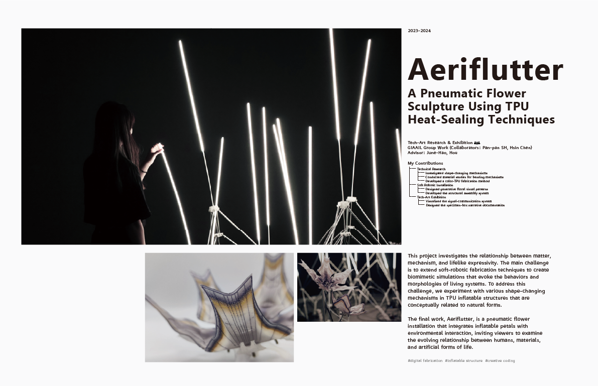
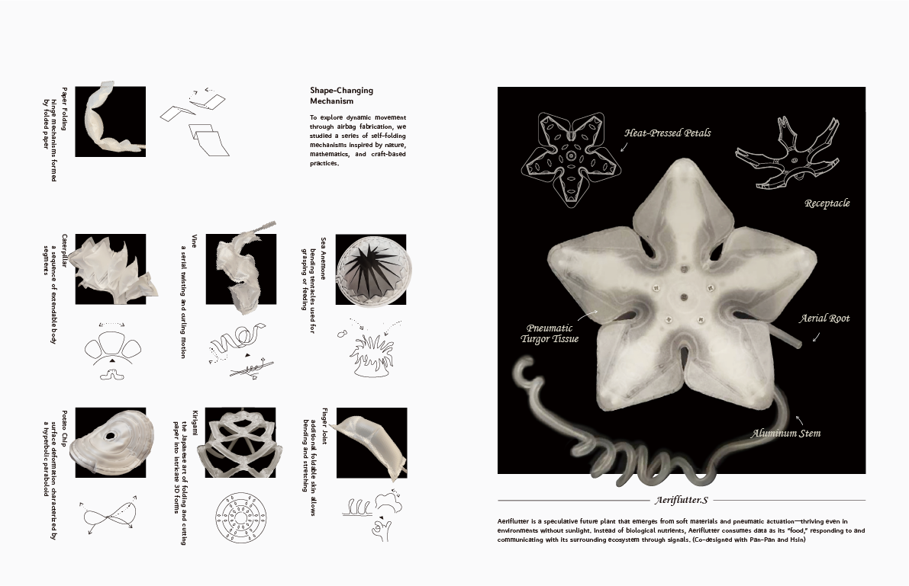
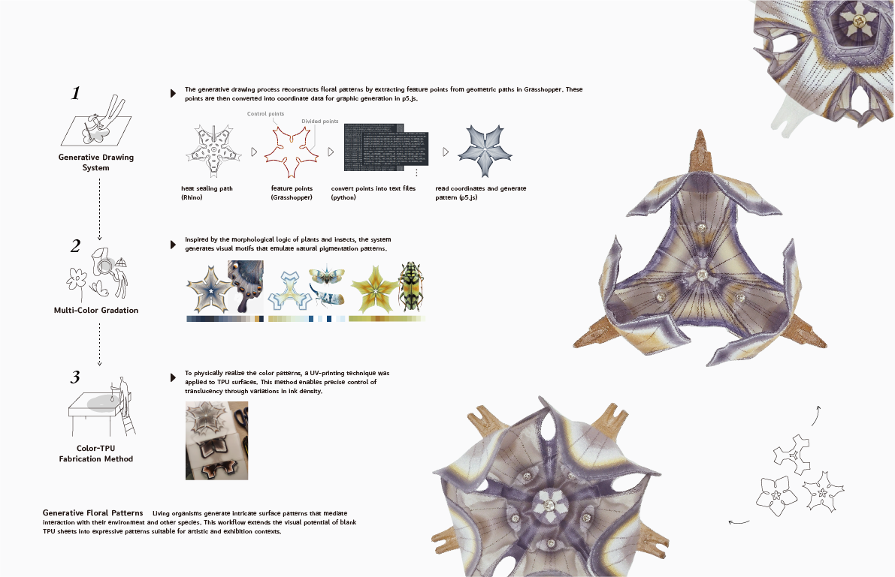
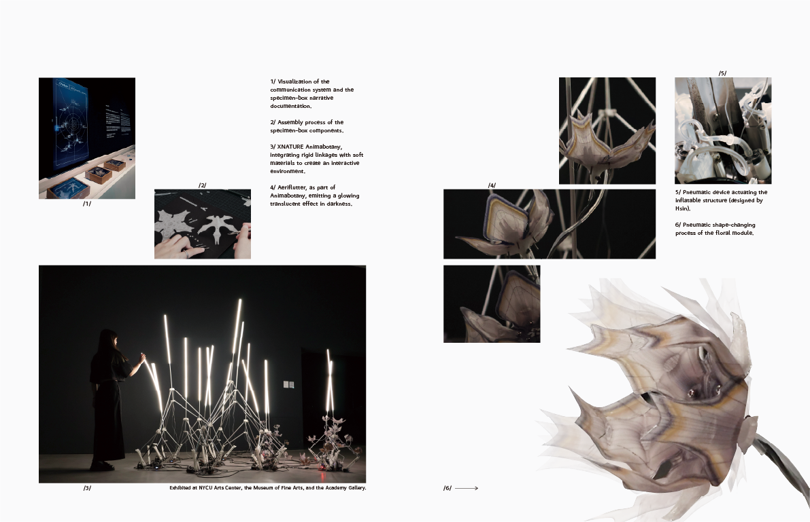

*Aeriflutter* is a GIAAIL laboratory team project that explores how soft materials and simple mechanisms can create lifelike movement. Inspired by flowers, vines, caterpillars, sea anemones, paper folding, and kirigami, we developed shape-changing structures from heat-sealed TPU. Air pressure opens, bends, and curls the petals, making the sculpture behave like a speculative plant. The work is part of *Non-Carbon-Based Botany* and was exhibited at the Kaohsiung Museum of Fine Arts. It invites viewers to think about the relationship between humans, materials, and artificial forms of life.

Developed with Pan-pan Shih and Hsin Chen as part of the GIAAIL team.

[View the exhibition at the Kaohsiung Museum of Fine Arts](https://www.kmfa.gov.tw/exhibitiondetailc001100.aspx?Cond=6e0c65c3-d02d-4d26-ac43-9acfa40eddb8)

<video
  controls
  playsinline
  preload="metadata"
  poster="/images/projects/aeriflutter/05-aeriflutter-demo-poster.webp"
  style="display: block; width: 100%; height: auto;"
>
  <source src="/images/projects/aeriflutter/05-aeriflutter-demo.mp4" type="video/mp4" />
  Your browser does not support the video tag.
</video>

