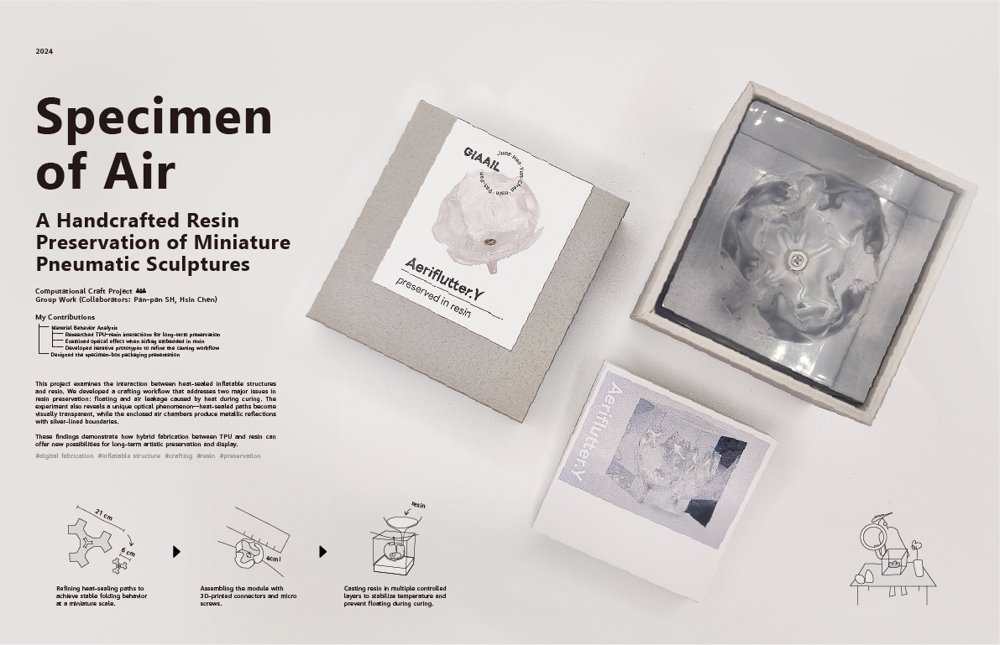
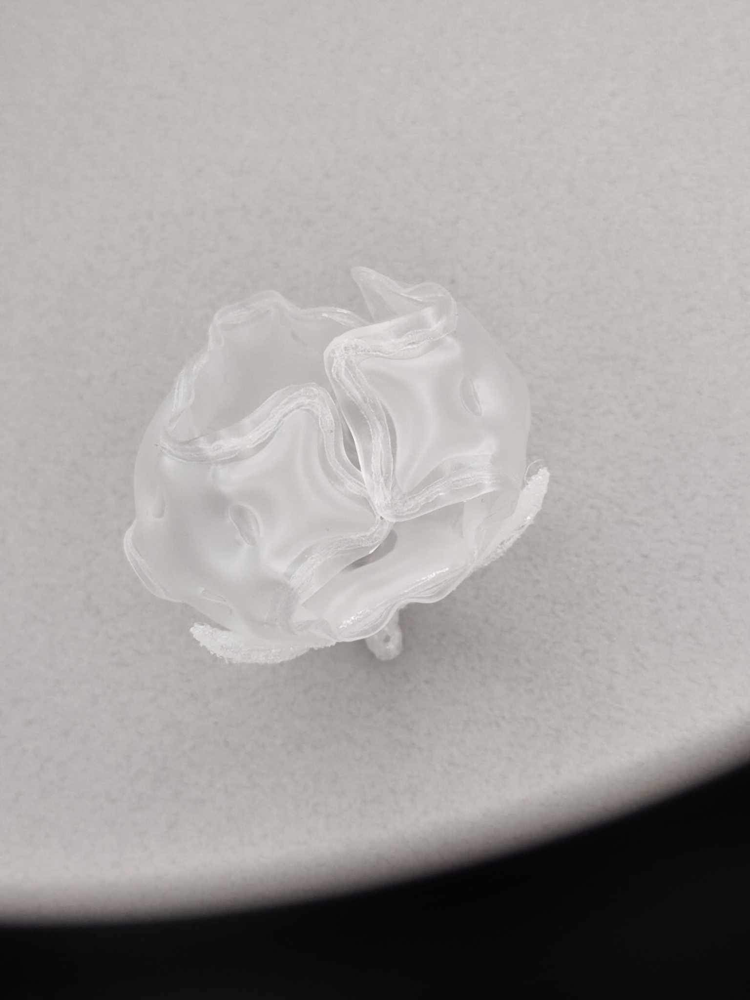
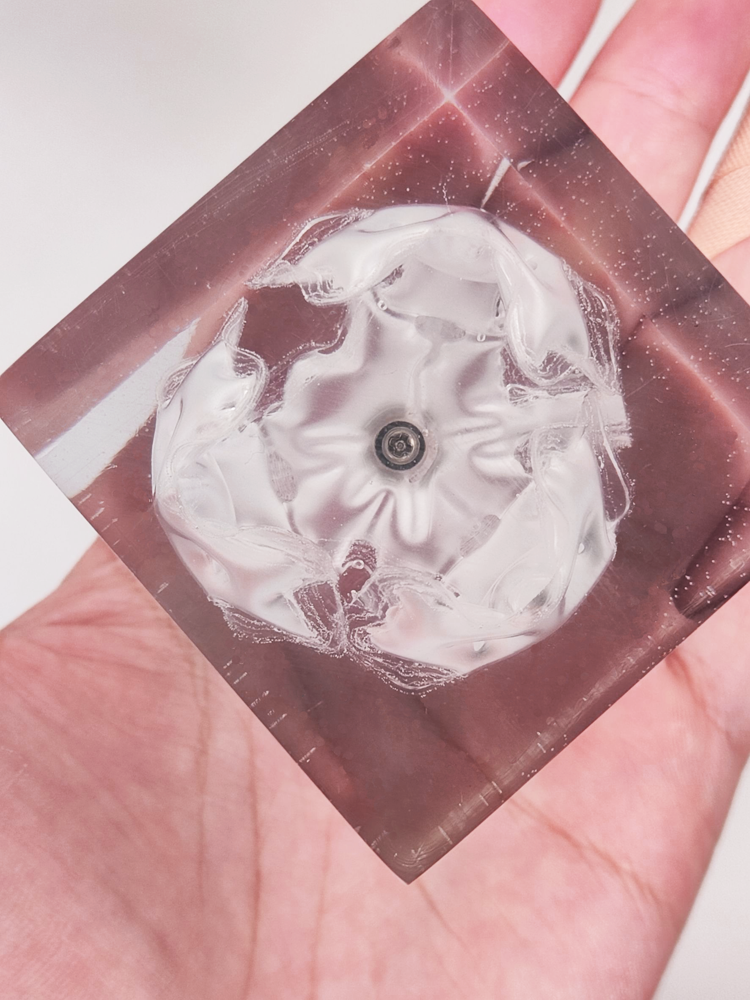

## 空氣植物標本 / Specimen of Air

《Specimen of Air》探索熱封充氣結構與樹脂之間的材料互動。作品發展一套手工保存流程，將微型 TPU 充氣雕塑封存在多層樹脂中，同時處理固化時產生的漂浮、漏氣與溫度問題。實驗發現，熱封路徑在樹脂中會變得透明，而封閉的氣室會產生帶有銀色邊緣的金屬反光。這項研究展示了 TPU 與樹脂結合在長期保存與藝術展示上的可能性。

*Specimen of Air* explores the material interaction between heat-sealed inflatable structures and resin. The project develops a handmade process for preserving miniature TPU pneumatic sculptures inside several controlled layers of resin. It also responds to problems such as floating, air leakage, and heat during curing. The experiment shows that heat-sealed paths become transparent in resin, while enclosed air chambers create metallic reflections with silver-lined edges. The project demonstrates how TPU and resin can support long-term artistic preservation and display.

