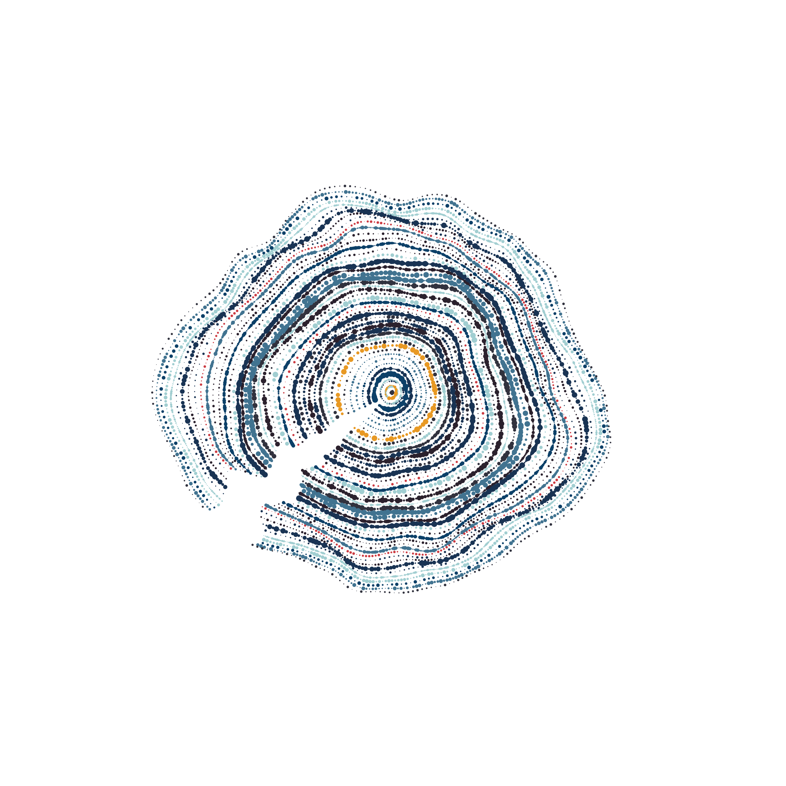
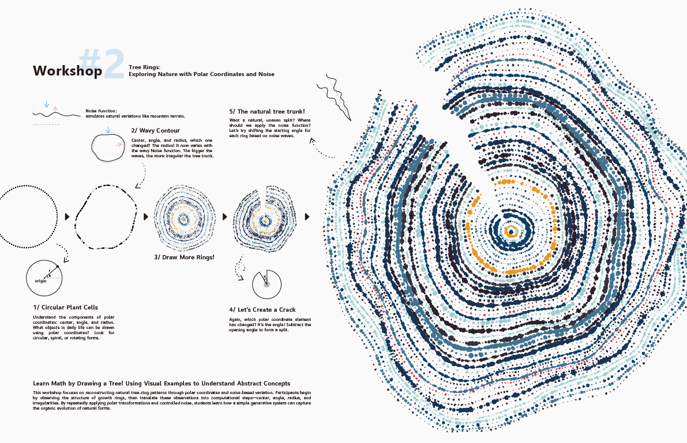

## 時間回聲 / Echoes of Growth

時間回聲 Echoes of Growth 從樹木年輪汲取靈感，描繪了時間的節奏脈動，使自然的生命週期如煙火般一一綻放。此作品透過同心圓與噪聲構成的演算法生成模式，探索了循環和無限的時間概念，植物細胞的顏色與大小微妙地變化，反映了季節與樹木環境的相互作用，創造動與靜的微妙平衡。

*Echoes of Growth* is inspired by tree rings and the rhythms of time found in nature. The work uses an algorithm built with concentric circles, polar coordinates, and noise to create patterns that grow and change like living cells. Small changes in color and size suggest the effects of seasons and the surrounding environment. Presented through large-scale projection, the moving rings explore cycles, growth, and the balance between stillness and motion.

<video controls playsInline preload="metadata" poster="/images/projects/echoes-of-growth/video-poster.webp">
  <source src="/images/projects/echoes-of-growth/echoes-of-growth.mp4" type="video/mp4" />
  Your browser does not support embedded video. You can <a href="/images/projects/echoes-of-growth/echoes-of-growth.mp4">open the video directly</a>.
</video>

