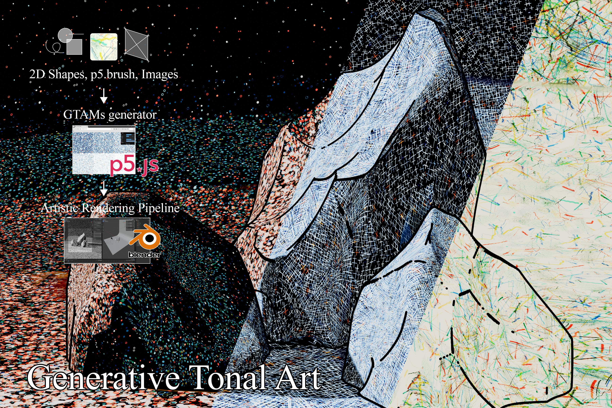
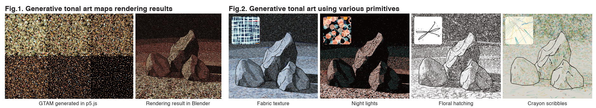
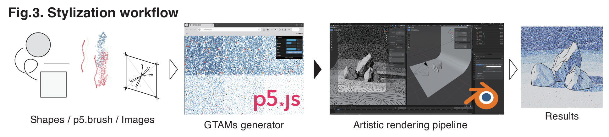
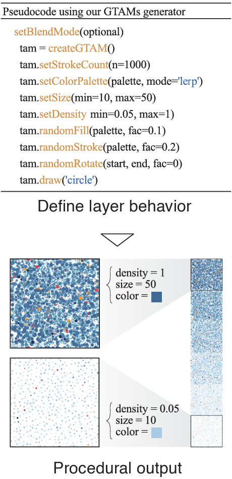
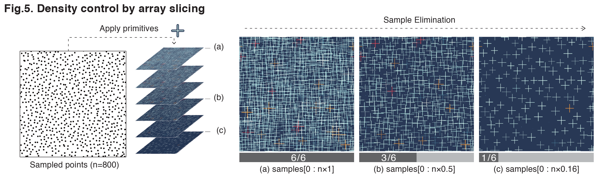
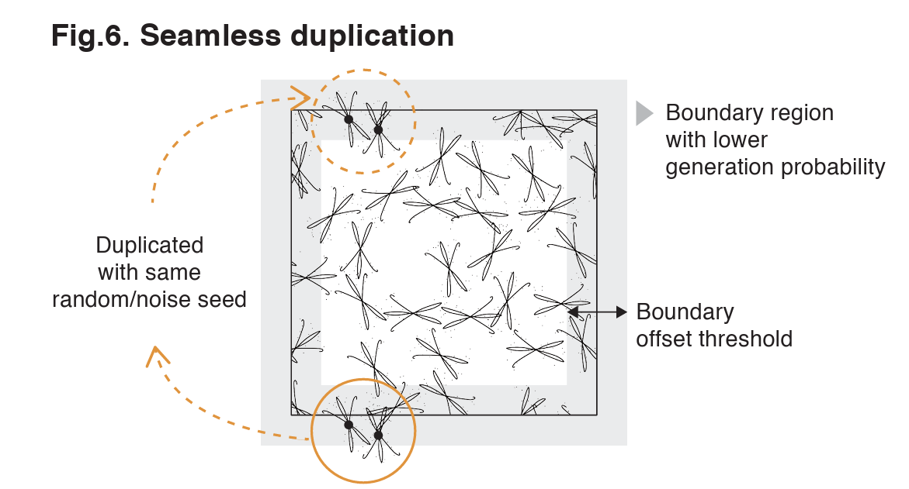
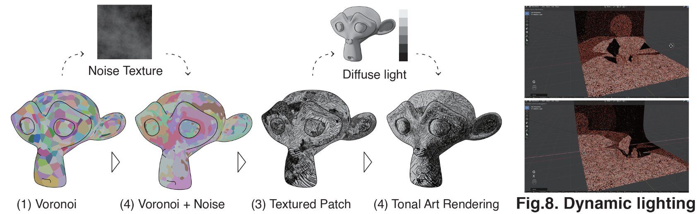

## 生成式調性藝術 / Generative Tonal Art

《Generative Tonal Art》提出一套連結生成藝術與非寫實渲染（NPR）的創作流程。藝術家可以在 p5.js 中使用形狀、筆觸或圖片建立自訂的生成式調性藝術貼圖（GTAMs），不需要進階的 shader 程式設計。這些貼圖接著被匯入 Blender，依照 3D 場景中的動態光線產生不同明暗層次。此方法讓藝術家可以更容易地設計、測試並分享個人化的 3D 渲染風格。

*Generative Tonal Art* presents a workflow that connects generative art with non-photorealistic rendering (NPR). Artists can use shapes, brushstrokes, or images in p5.js to create custom Generative Tonal Art Maps (GTAMs) without advanced shader programming. The maps are then imported into Blender, where different tonal layers respond to dynamic lighting in a 3D scene. This method makes it easier for artists to design, test, and share their own rendering styles.

[Read the published paper on the ACM Digital Library](https://dl.acm.org/doi/10.1145/3757374.3771537)

### Overview

This study proposes a workflow that bridges the gap between generative art and non-photorealistic rendering (NPR). Toon shaders provide an easy way to create 2D illustration-like styles for 3D scenes by adjusting simple parameters. However, achieving a unique and customizable visual style is challenging because it often requires manually painted inputs or advanced shader programming. Therefore, we introduce the concept of Generative Tonal Art Maps (GTAMs), which allow artists to easily create textures in p5.js, serving as a mediating layer between 2D generative design and 3D NPR.

### Process

Our workflow consists of two parts: (1) In p5.js, users define procedural drawing behaviors for each layer, and then our algorithm automatically generates GTAMs as image outputs. (2) The generated GTAMs are then imported into Blender through our tonal art rendering pipeline to achieve real-time NPR rendering.

### GTAMs Generator

In p5.js, GTAMs are generative value scales composed of multiple parametric layers. Each layer allows users to design the appearance and behavior of sampled points. The generator then automatically produces textures with three key properties: uniform stroke distribution, consistent nesting across tone levels, and seamless tiling for visually continuous results.

### Main Algorithm: Programmable GTAMs

To achieve uniform point distribution, we adopt sample elimination instead of traditional additive sampling. This method sorts points by their elimination order, allowing users to control density simply by slicing a subset of samples, without regenerating them from scratch. To ensure the stroke nesting property, each stroke is assigned a unique random seed so that its appearance remains consistent across tone levels. For seamlessness, a boundary offset threshold is defined based on stroke size. Strokes within this boundary region are duplicated to the opposite side, ensuring continuous and tileable textures.

### Tonal Art Rendering Pipeline

The GTAM is integrated into a toon-shader framework, where tonal layers are sampled by diffuse lighting. To reduce visible tiling, camouflage-like patches with local noise-based rotation create natural stroke patterns.

