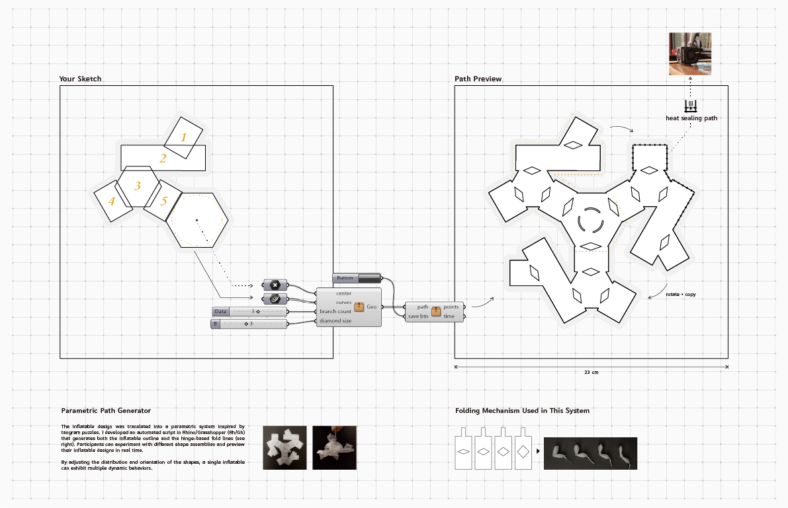
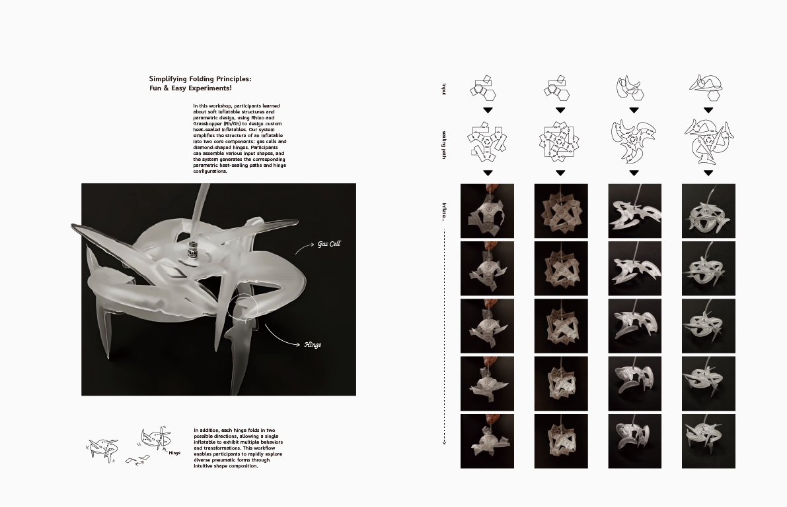
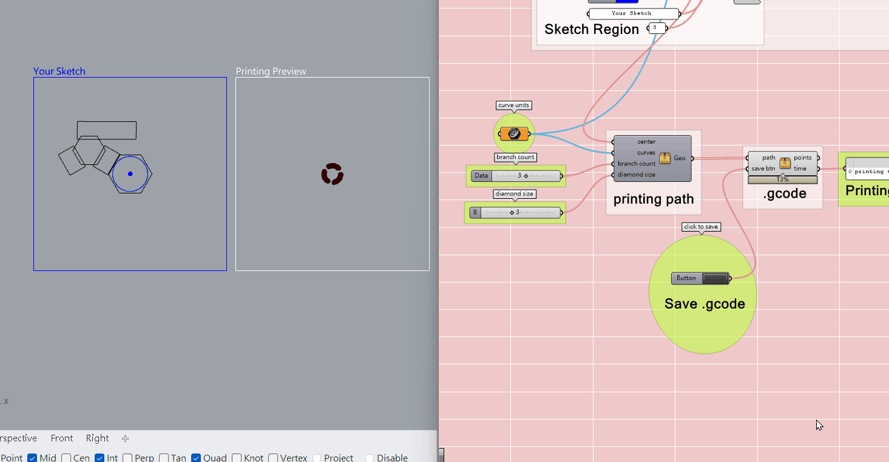
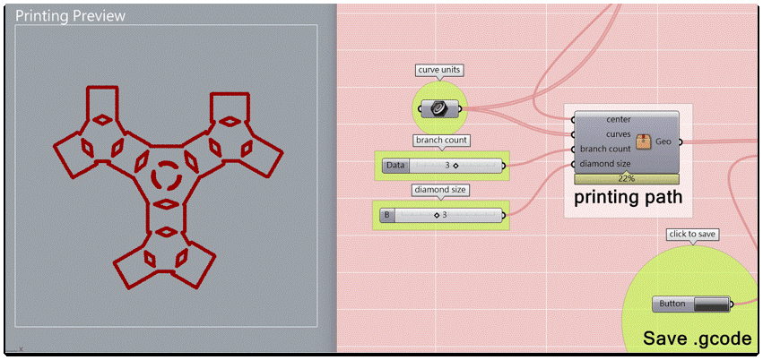
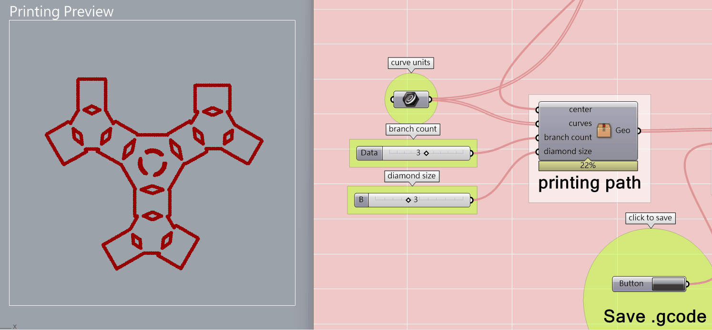

## 動態氣囊創意工作坊 / Dynamic Inflatable Workshop

《Dynamic Inflatable》是一項團體合作的公共工作坊計畫，於高雄市立美術館舉行。工作坊在三小時內帶領參與者認識參數化設計與熱封充氣結構。我們開發了一套以 Grasshopper 為基礎的參數化封合路徑生成器，讓使用者能以類似七巧板的介面排列基本形狀，系統再自動產生氣室、摺疊鉸鏈與熱封路徑。平面的 TPU 薄膜充氣後會摺疊成不同的立體生物，讓參與者透過簡單的流程自由探索形態與動態變化。

*Dynamic Inflatable* is a group project developed as a public workshop at the Kaohsiung Museum of Fine Arts. In a three-hour session, participants explored parametric design and heat-sealed inflatable fabrication. Our team created a Grasshopper-based sealing-path generator that allows users to arrange basic shapes through a tangram-like interface. The system then produces air chambers, folding hinges, and heat-sealing paths automatically. When inflated, the flat TPU sheets fold into different three-dimensional creatures, allowing participants to explore form and movement through a simple and playful process.

[View the workshop information](https://nstc-artstech.net/events/workshop/226466.html)

<ImageGrid
  columns={2}
  aspect="4 / 3"
  images={[
    {
      src: "/images/projects/inflatable-creatures/03-inflatable-creature.gif",
      alt: "Inflatable creature expanding into a curved structure",
    },
    {
      src: "/images/projects/inflatable-creatures/04-inflatable-creature.gif",
      alt: "Inflatable creature opening into a flat branching form",
    },
    {
      src: "/images/projects/inflatable-creatures/05-inflatable-creature.gif",
      alt: "Inflatable creature folding into a compact form",
    },
    {
      src: "/images/projects/inflatable-creatures/06-inflatable-creature.gif",
      alt: "Inflatable creature changing shape through connected gas cells",
    },
  ]}
/>

