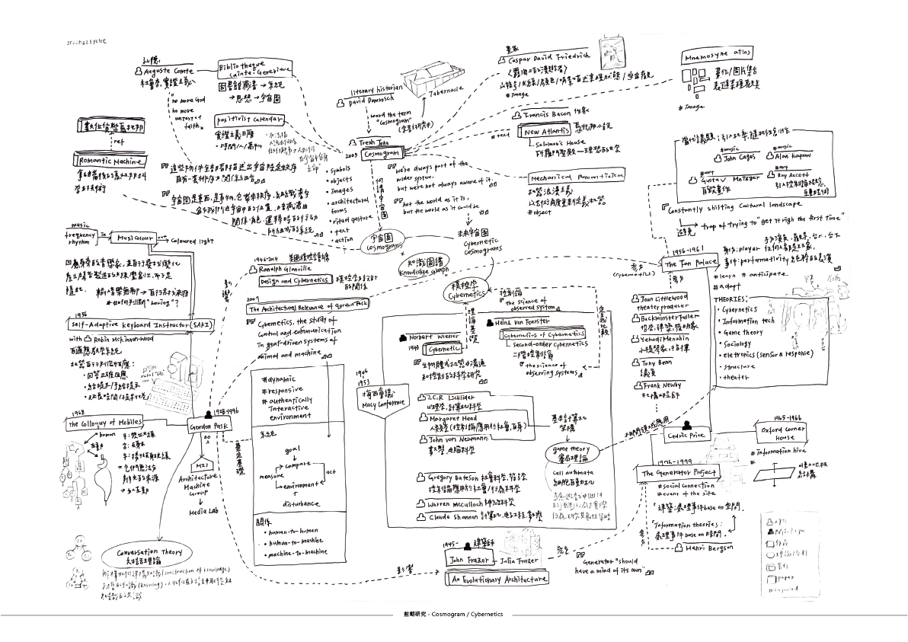
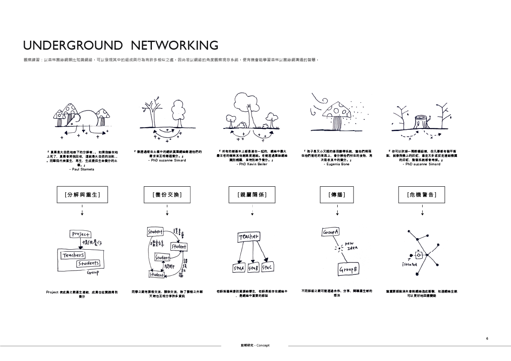
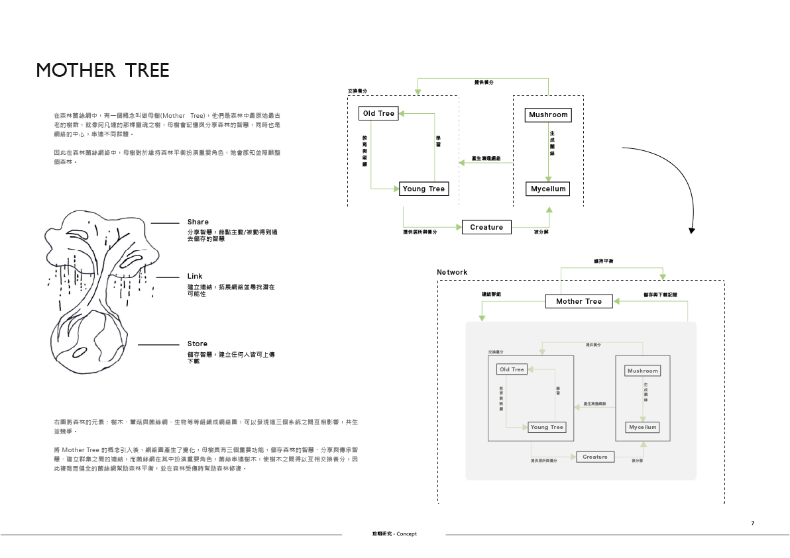
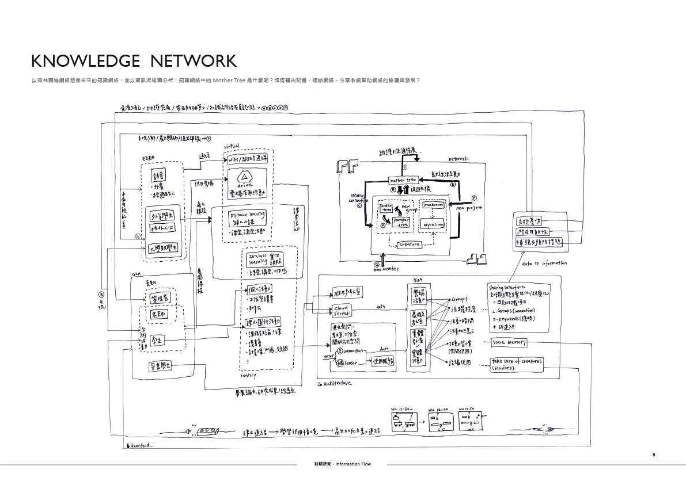
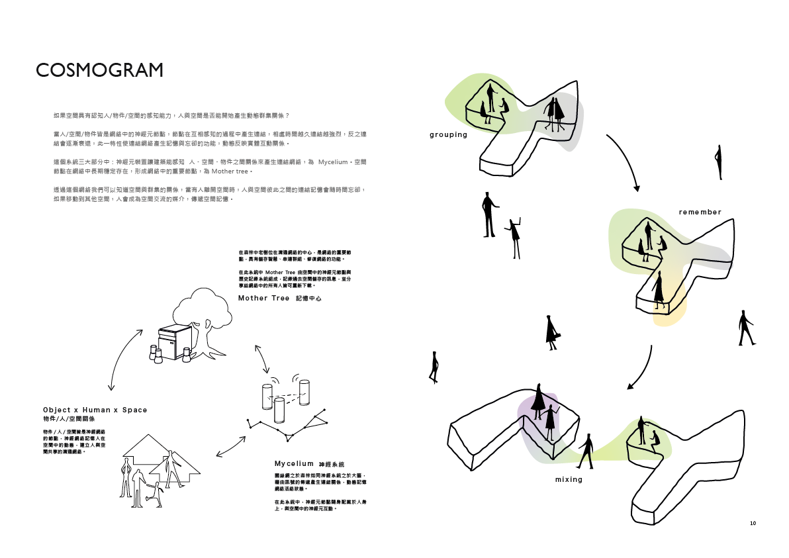
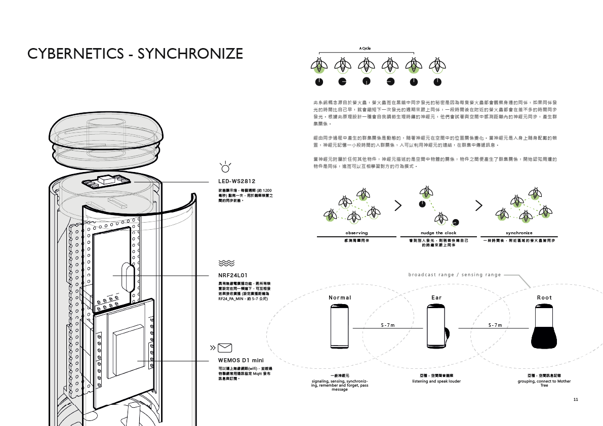
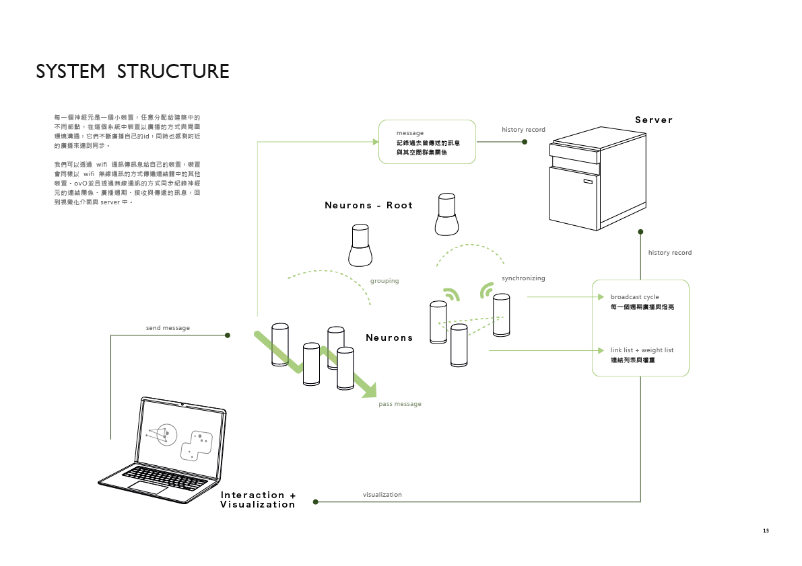
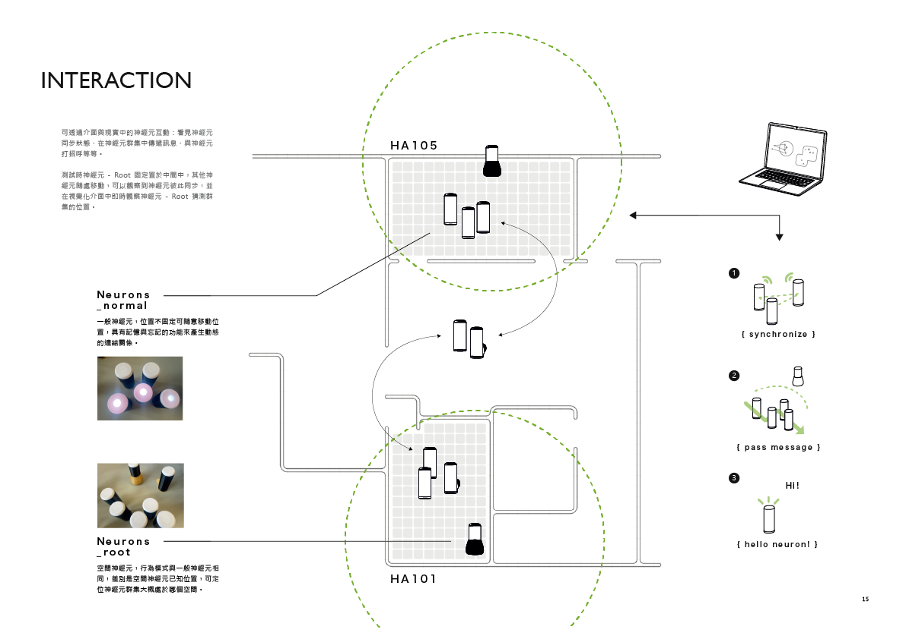
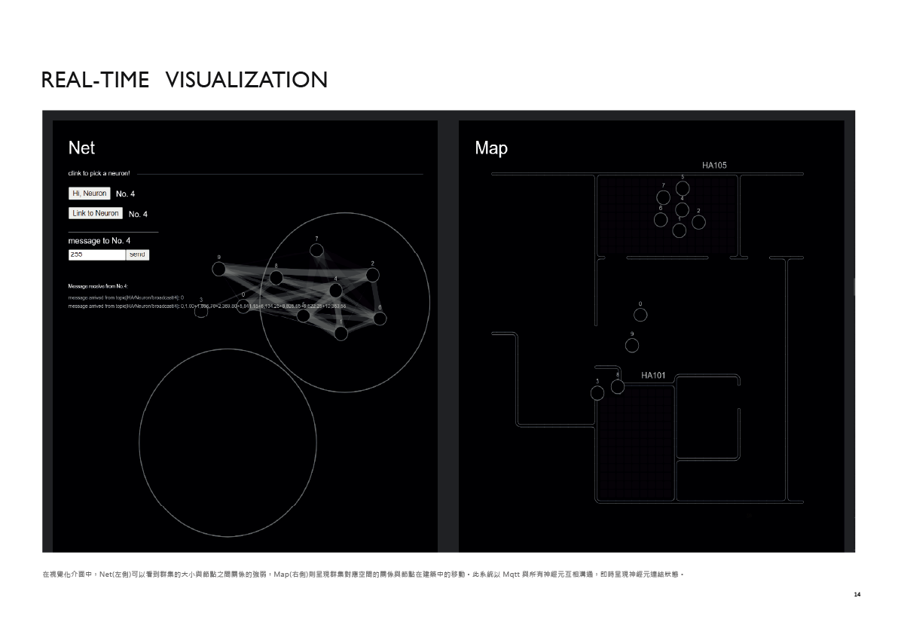
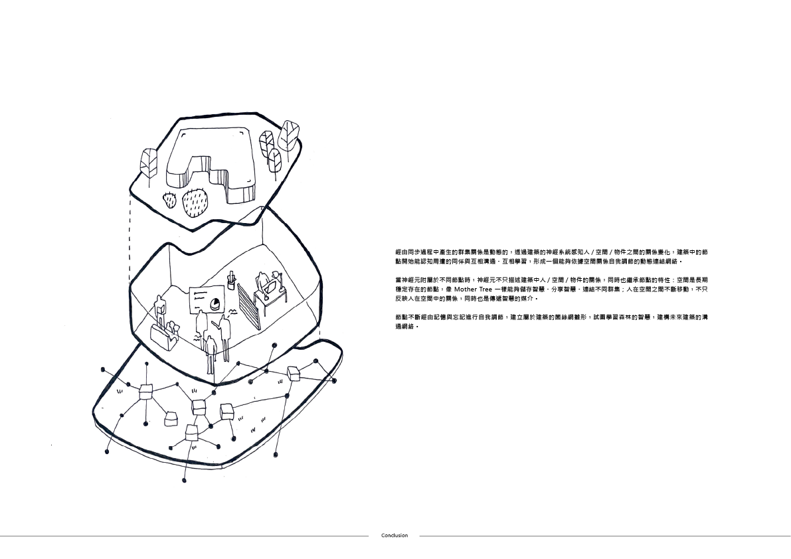

## 當建築學會認知 / When Architecture Knows

《When Architecture Knows》以森林中的菌絲網絡與「母樹」為靈感，探索建築如何感知、記憶並分享空間中的資訊。分散在建築內的神經元裝置會觀察附近的裝置，透過無線網絡同步燈光、傳遞訊息並形成群體；根節點則像母樹一樣連接不同區域。系統將互動紀錄保存於伺服器，並以即時視覺化呈現裝置的位置與關係，讓人、物件與空間共同組成一個持續變化的知識網絡。

*When Architecture Knows* is inspired by fungal networks and the “Mother Tree” in a forest. It explores how architecture can sense, remember, and share information across a space. Small neuron devices observe nearby units, synchronize their lights, pass messages, and form groups through a wireless network. Root units connect different areas like mother trees. The system stores its interaction history on a server and shows the changing locations and relationships in real time, allowing people, objects, and space to become part of an evolving knowledge network.

