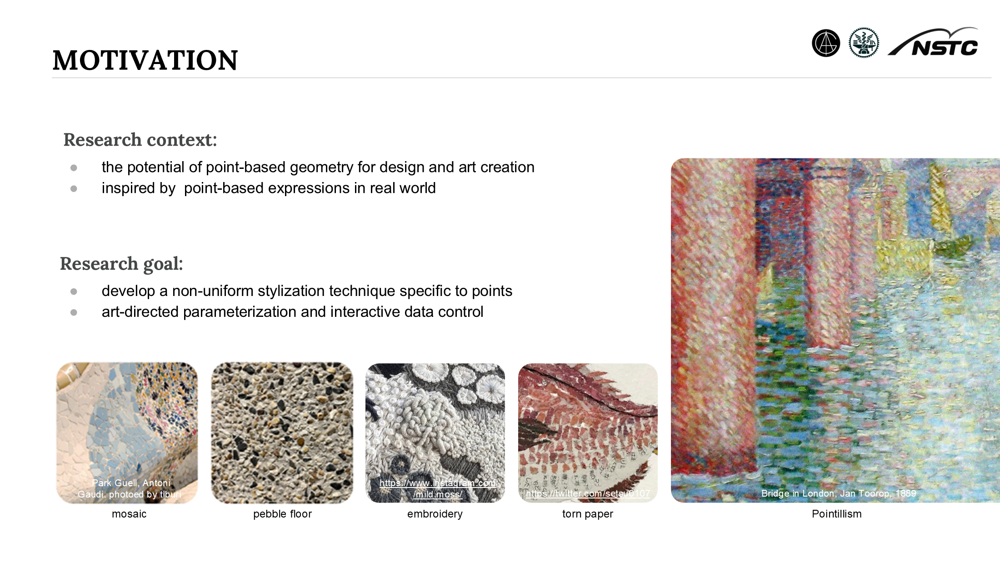
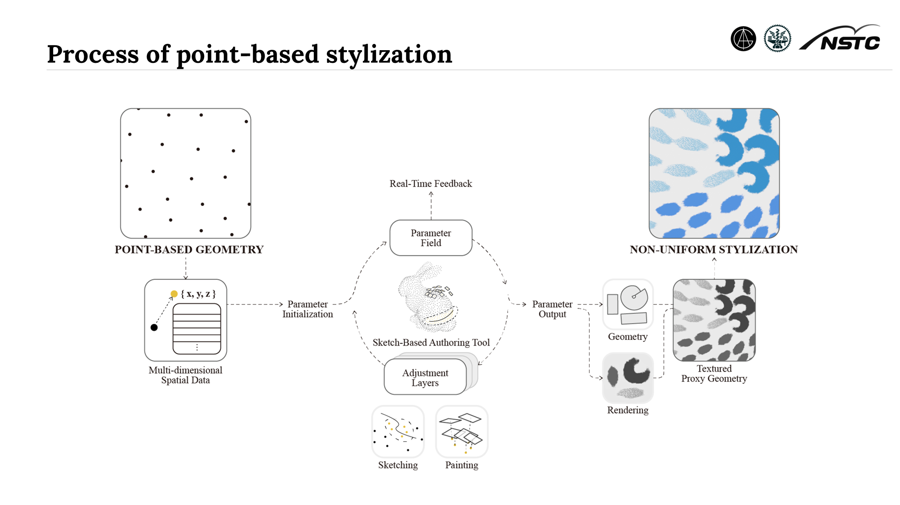
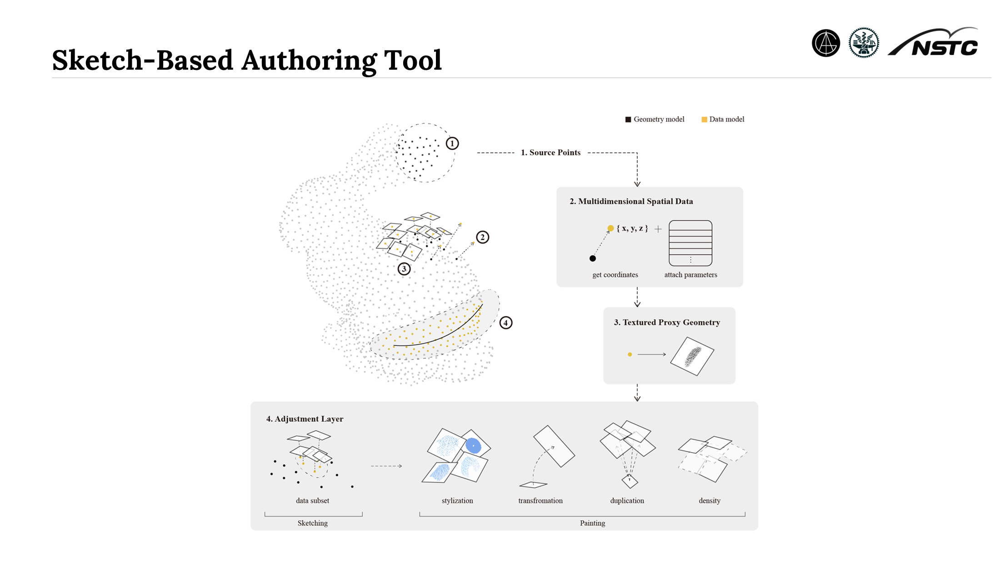
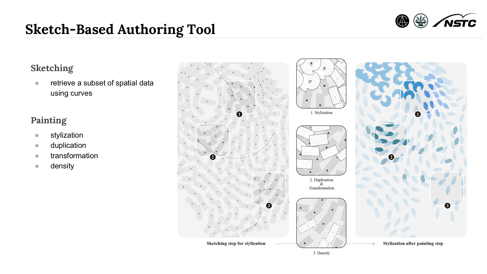
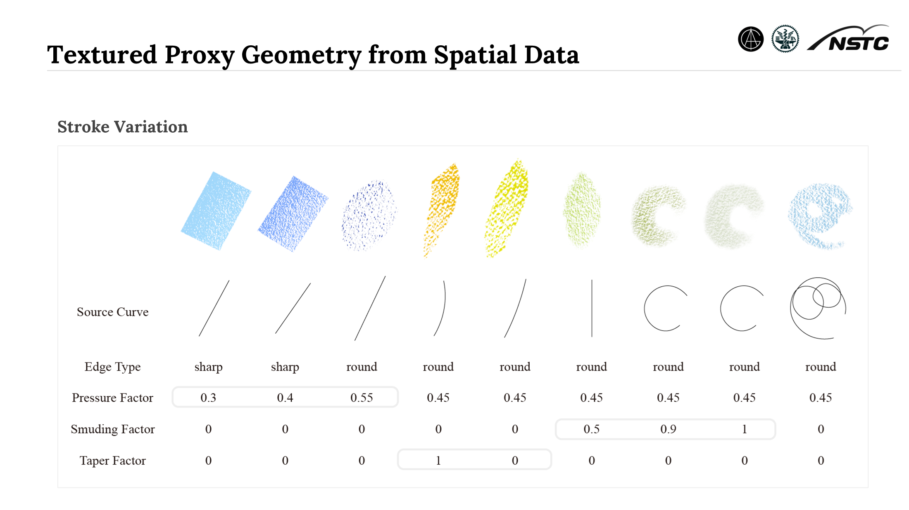
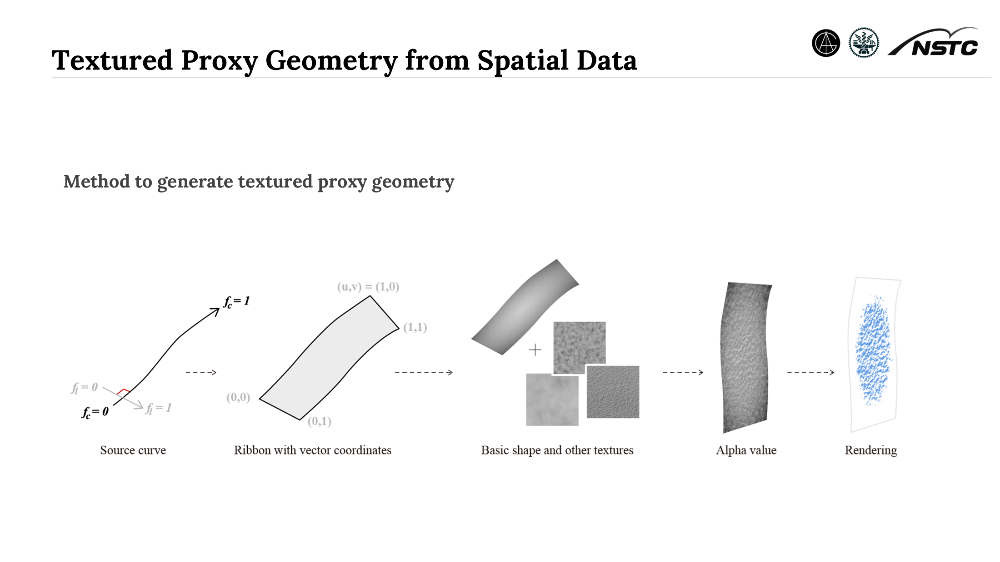
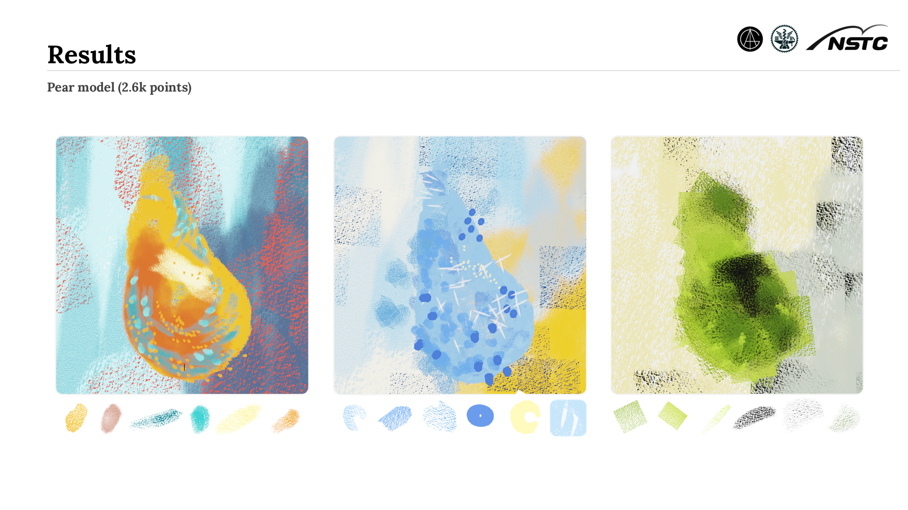
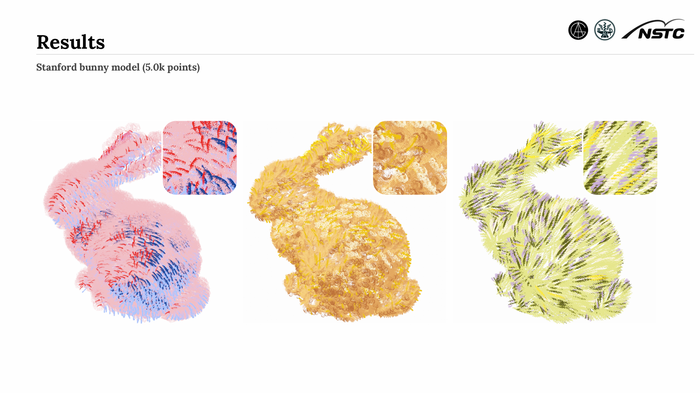

---

Point-Based Stylization explores how point-based geometry can support art and design. The system turns each point into multidimensional spatial data and gives artists direct control through a sketch-based authoring tool. Users can select areas with curves, then adjust style, duplication, transformation, and density in separate layers. Textured proxy geometry adds different stroke shapes and material effects to the points. This method creates non-uniform, art-directed results while giving real-time visual feedback.

title: "Point-Based Stylization"
subTitle: "GLSL X Point Cloud"
tags: ["Point cloud", "Oil pastel", "GLSL", "Blender"]
date: 2023-09-16
cover: 
    src: "/images/projects/point-based-stylization/cover-2.webp"
    alt: "Point-Based Stylization"
status: "Published"
visible: true

---

 
