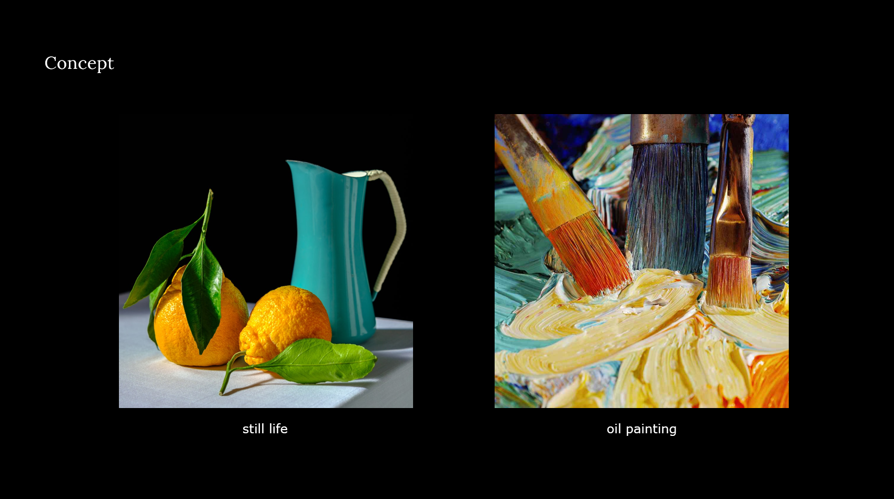
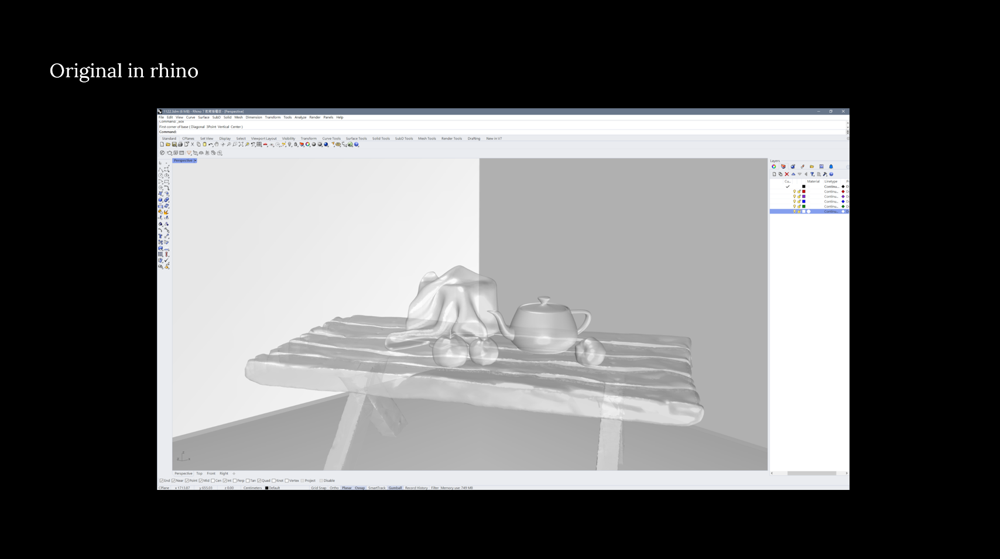
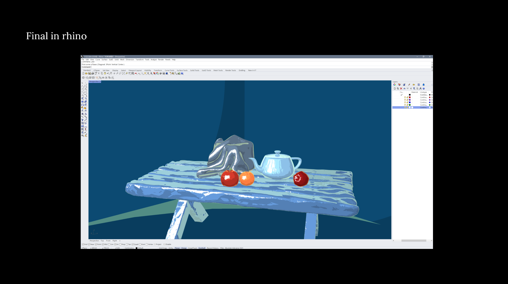
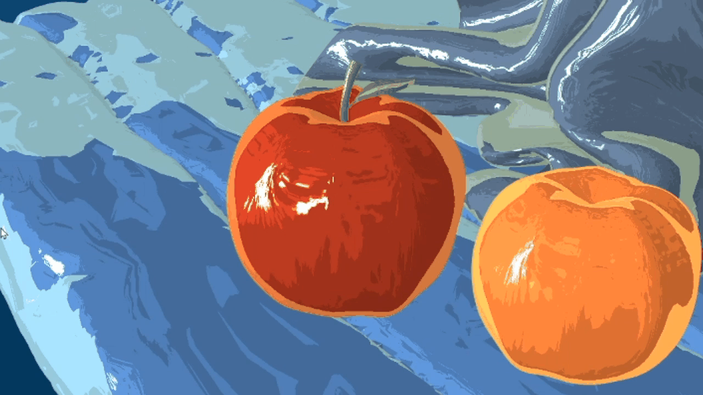
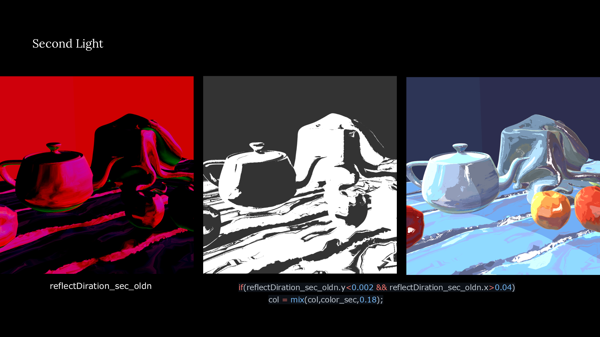
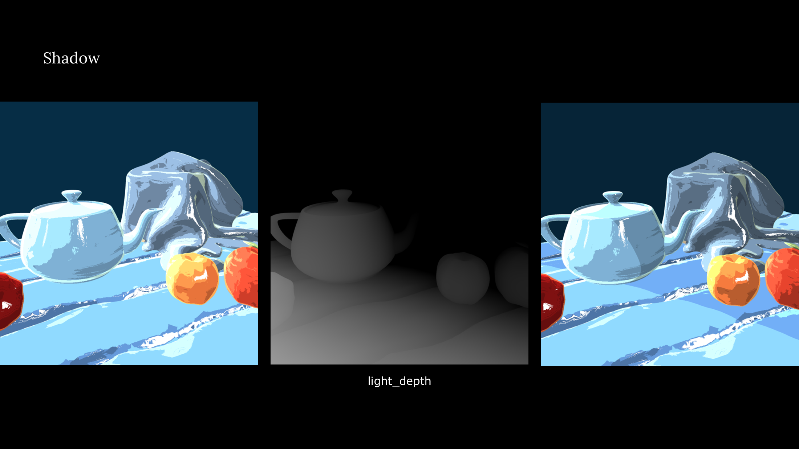
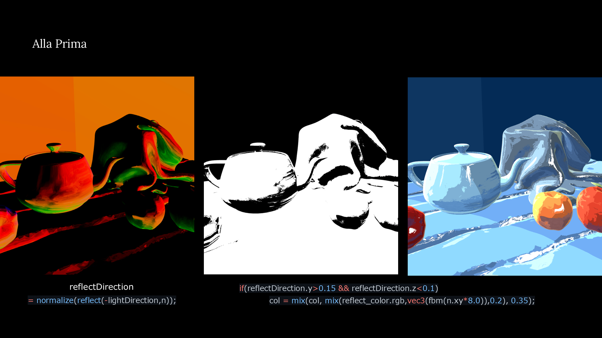
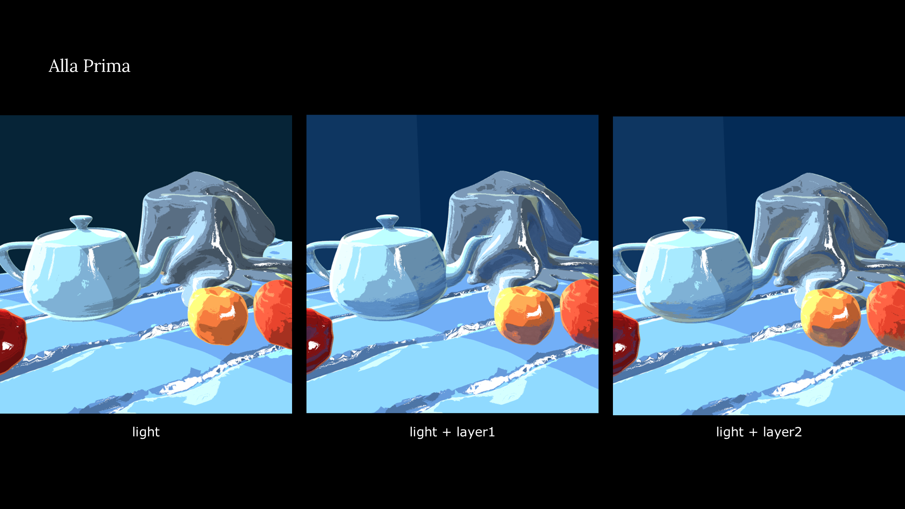
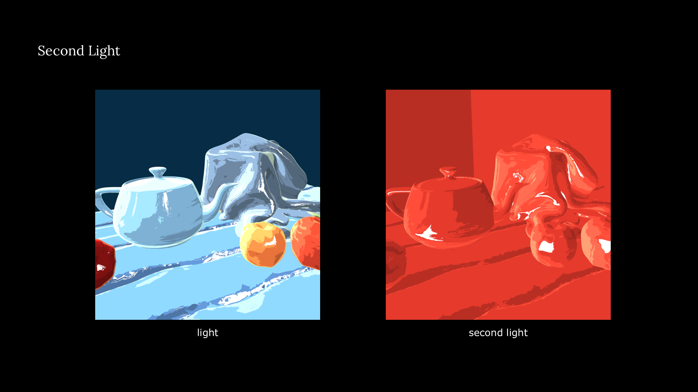
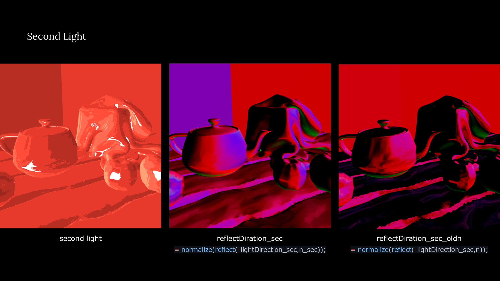

## 靜物畫 / Still Life

《Still Life》是一項結合 3D 建模、p5.js 與 GLSL shader 的非寫實渲染實驗。作品從傳統油畫的直接畫法（Alla Prima）出發，將光線、陰影、反射與色彩拆解成不同的運算層次，再重新組合於數位靜物場景中。透過調整主光源、第二光源與物件表面的反射，畫面呈現出接近油畫筆觸與色塊堆疊的視覺效果。

*Still Life* is a non-photorealistic rendering experiment that combines 3D modeling, p5.js, and GLSL shaders. Inspired by the direct painting method of Alla Prima, the project separates light, shadow, reflection, and color into different computational layers, then combines them in a digital still-life scene. By adjusting the main light, a second light, and surface reflections, the shader creates a visual effect that resembles layered colors and brushstrokes in an oil painting.

[View the live demo](https://yunchen-lee.github.io/HSAA30062_p5shader_stillLife/)  /  [View the source code on GitHub](https://github.com/yunchen-lee/HSAA30062_p5shader_stillLife)

