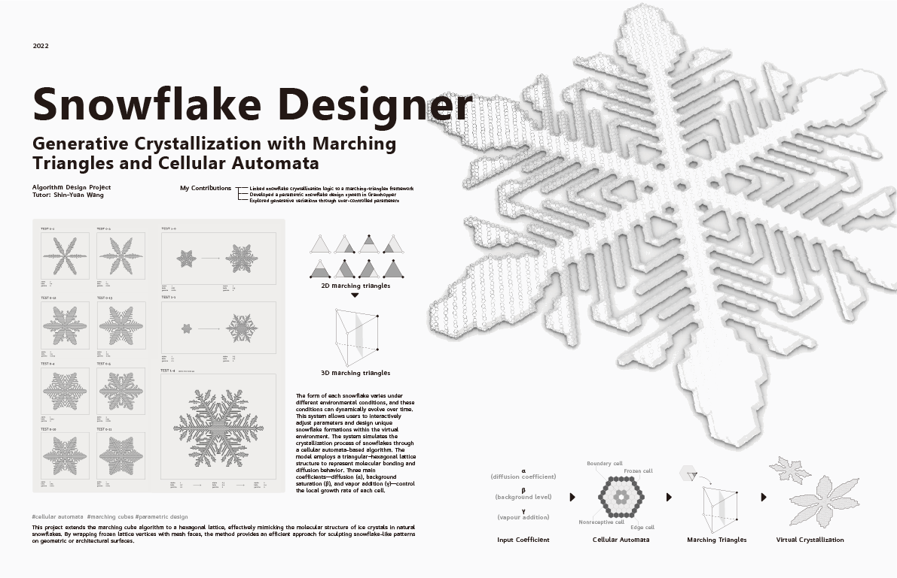

Snowflake Designer is a nature-inspired generative design project that studies how snow crystals grow. The system uses cellular automata to simulate crystallization on a hexagonal grid, then maps the frozen cells into a marching-triangles structure. In Grasshopper, users can adjust diffusion, background, and vapour parameters to create different snowflake forms. This process turns changes in the environment into unique virtual snowflakes and offers a simple way to explore natural growth through parametric design.

[p5.js 2D simulator](https://github.com/yunchen-lee/IAR5262_p5_Snowflake_CellularAutomata)

[Grasshopper and marching-triangles system](https://github.com/yunchen-lee/IAR5262_gh_Snowflake_CA-MarchingCube)

<video
  controls
  playsinline
  preload="metadata"
  poster="/images/projects/snowflake-gh/02-snowflake-demo-poster.webp"
  style="display: block; width: 100%; height: auto;"
>
  <source src="/images/projects/snowflake-gh/02-snowflake-demo.mp4" type="video/mp4" />
  Your browser does not support the video tag.
</video>
