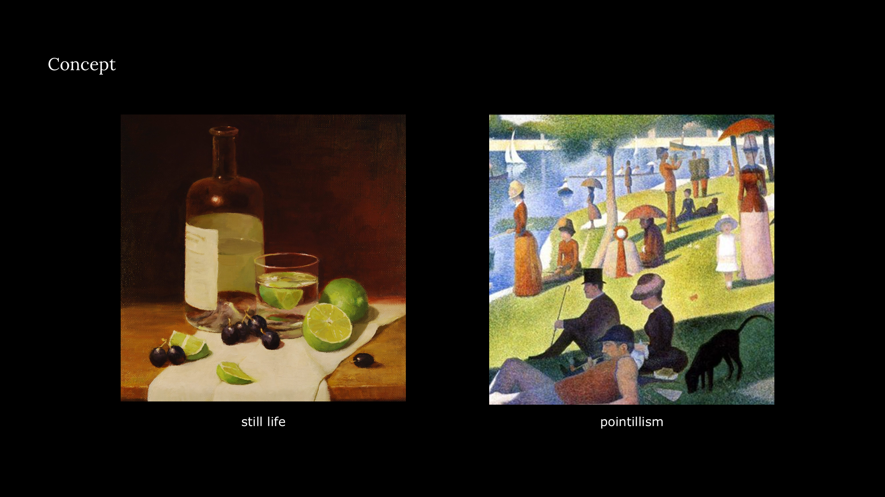
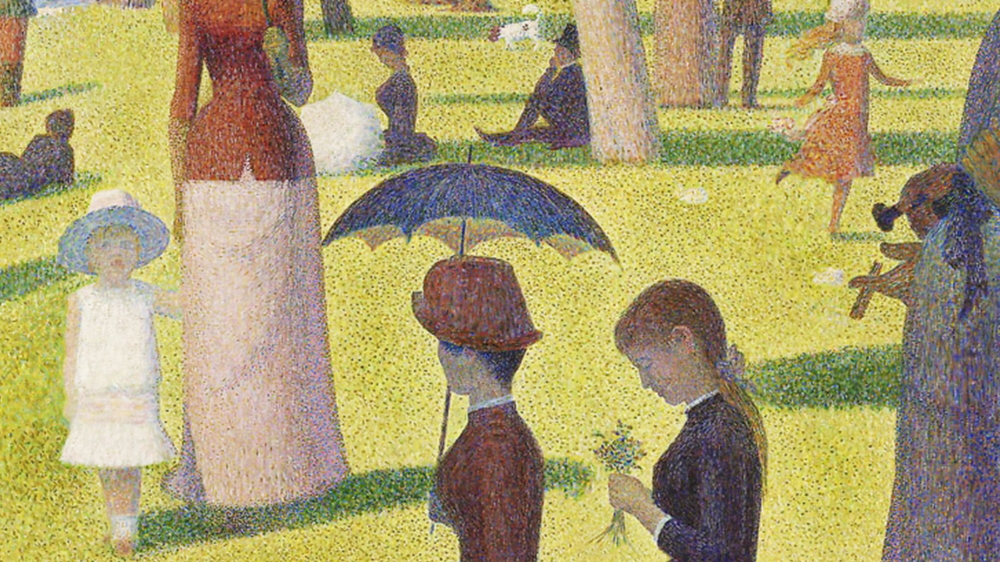
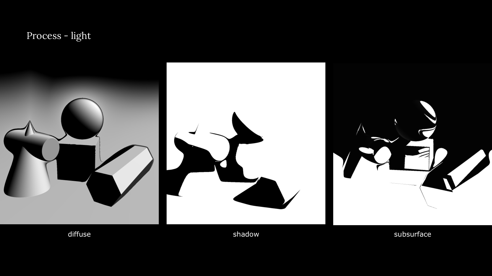
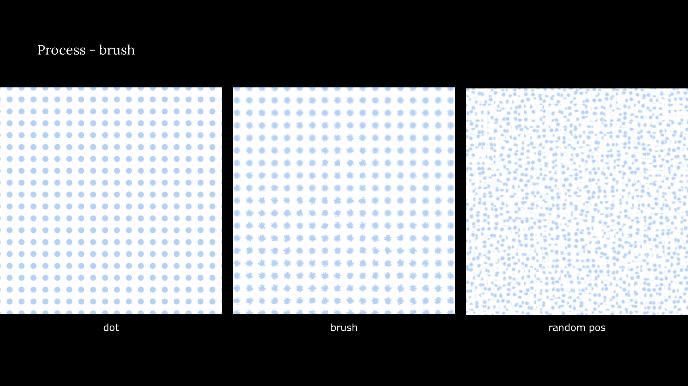
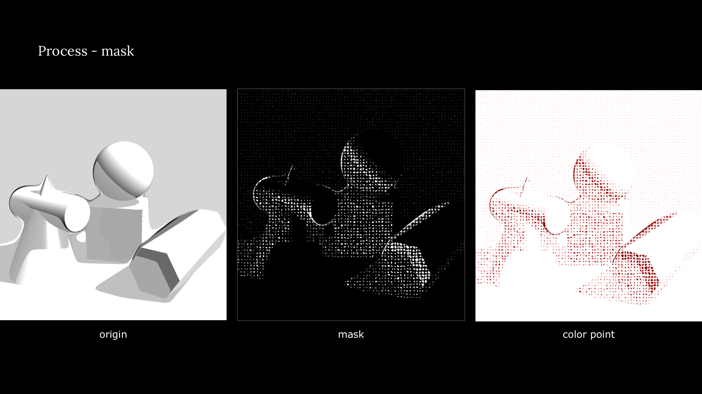
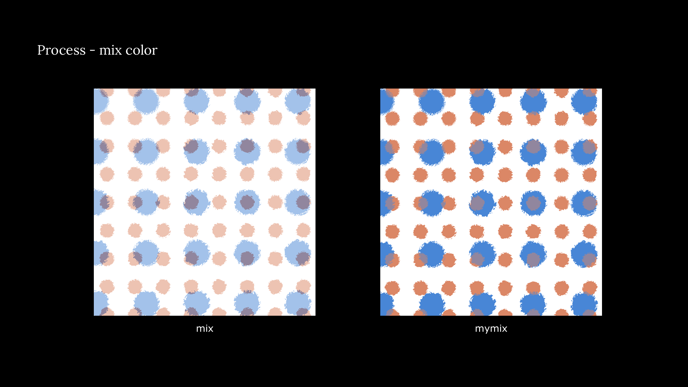
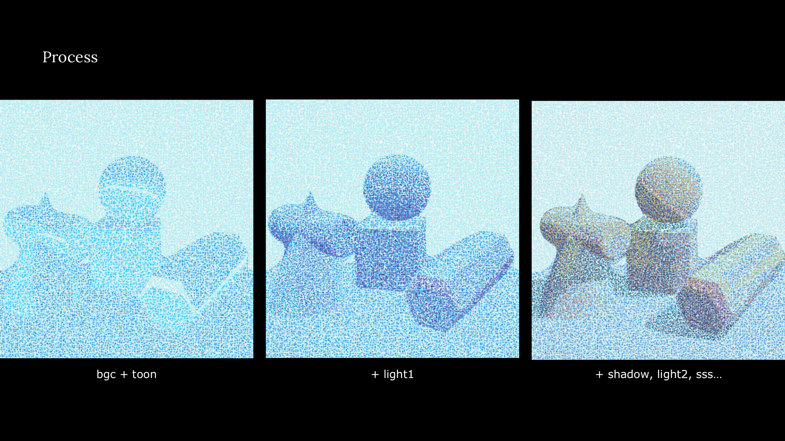
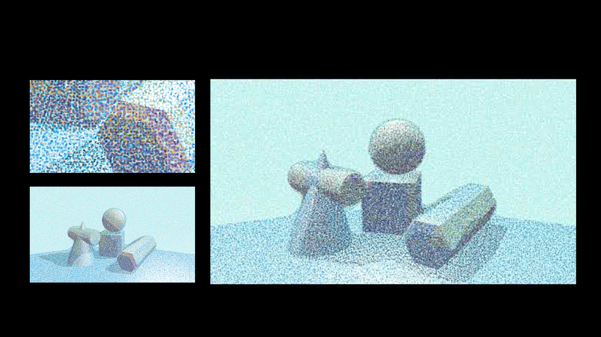

Still A-life is a real-time GLSL experiment that turns a digital still life into a pointillist image. I first built the objects with signed distance functions (SDFs) and rendered the scene through ray marching. Noise then breaks the image into small dots. Different colors are applied to the light, shadow, and surface layers, and a custom color-mixing method combines them into the final image. Because the lighting is calculated in real time, the pointillist scene changes as the light moves.

[View the source code on GitHub](https://github.com/yunchen-lee/HSAA30062_p5shader_geoStillLife_Pointillism)

<video
  controls
  playsinline
  preload="metadata"
  poster="/images/projects/still-alife/00-still-alife-demo-poster.webp"
  style="display: block; width: 100%; height: auto;"
>
  <source src="/images/projects/still-alife/00-still-alife-demo.mp4" type="video/mp4" />
  Your browser does not support the video tag.
</video>

