

# Stranger Viewfinder

*Stranger Viewfinder* is a pair of interactive binoculars designed for the Wollman Rink Overlook in Central Park. During our site observation, we found that visitors shared the same public space but focused on different views, including the sports courts, skyline, friends, phones, and passing strangers. This led us to ask how two people might exchange what they see.

Each binocular can rotate and tilt like a public viewing device. An ESP32 camera sends a live view through Wi-Fi to the display inside the other binocular, while a rotation sensor records its viewing direction. An on-screen icon shows where the other device is pointing. Through this system, one eye sees the surrounding space while the other receives another person’s view. The project explores how physical computing and shared vision can create moments of curiosity and connection between strangers.

Developed by T-Shape Ciabatta: Tinyi Hsu and Yun-Chen Lee.

## Location and Observation

We selected the Wollman Rink Overlook in Central Park. The overlook is not only a passage. Tables, railings, food, sports activities, and the skyline encourage visitors to stop and spend time there.

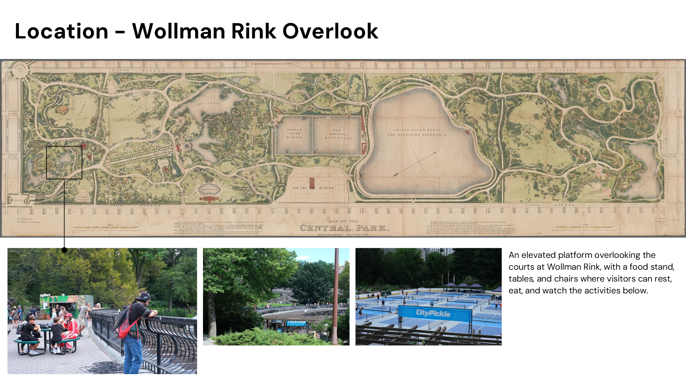

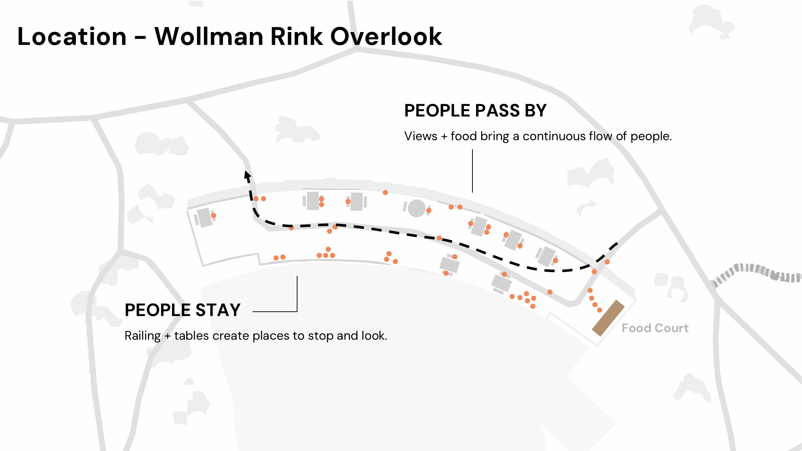

During our observation, we noticed that visitors looked at many different things. Some watched the sports courts, while others focused on friends, family members, phones, laptops, or people passing through the area. Although people shared the same location, they did not necessarily share what they were seeing.

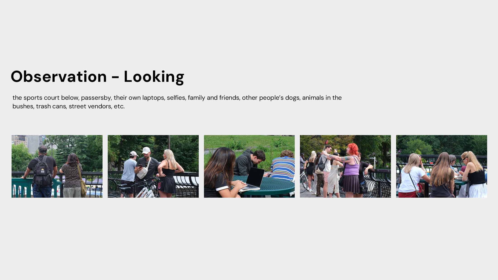

## Sharing What We See

This observation led to the main question: **Can an interaction allow strangers to share what they see?**

Binoculars naturally invite people to approach, look through them, rotate them, and explore distant views. We therefore designed two connected binoculars that exchange visual information. Instead of receiving only one view, each participant can become curious about where the other person is looking.

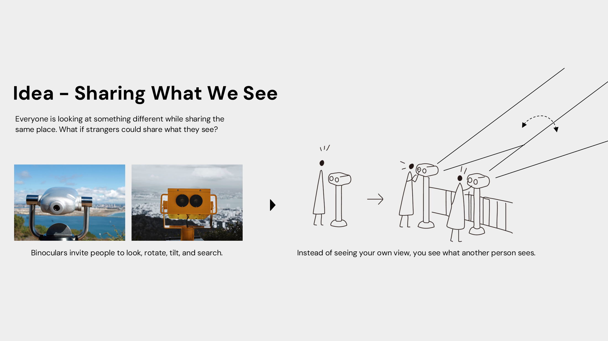

## System Design

The system combines three parts: object design, mechatronics, and interaction design.

### Object Design

Cardboard supported fast prototyping and allowed us to modify the form during development. Glue and paper towels created a harder surface, screws strengthened the structure, and paint gave the binoculars a visible and playful appearance. Like public binoculars, each object can rotate horizontally and tilt vertically.

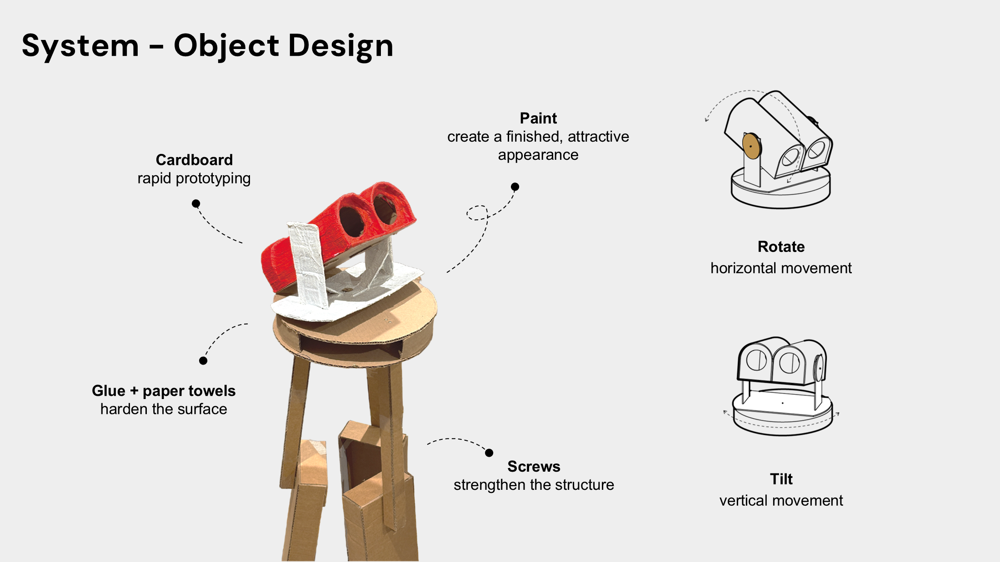

### Mechatronics

An ESP32 camera acts as the camera and controller. It sends live video through Wi-Fi to the display inside the other binocular. A rotation sensor detects the orientation of each device, allowing the system to exchange both the live image and its viewing direction.

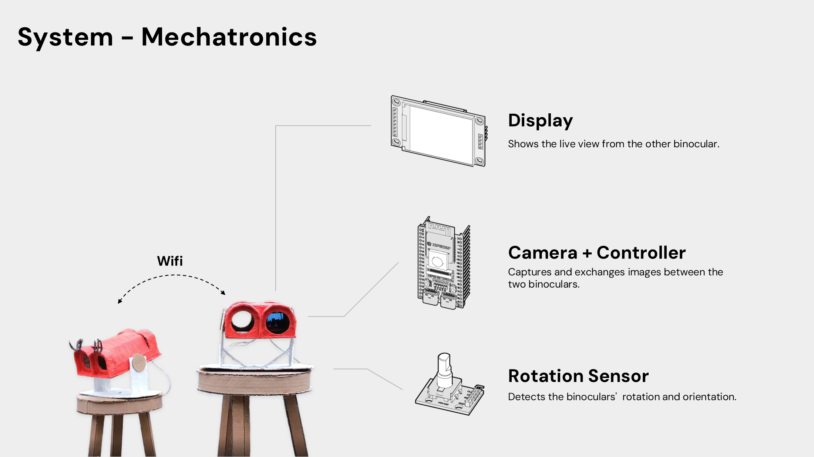

### Interaction Design

The final interaction focuses on connection and sharing. Eyelashes were added to the shorter binocular so that the two objects appear as a pair. A small arrow icon on the display shows the direction of the other binocular.

When one participant rotates a binocular, the other participant receives the changing live view and sees the direction icon move at the same time. One eye observes the surrounding space directly, while the other receives the view of another person.

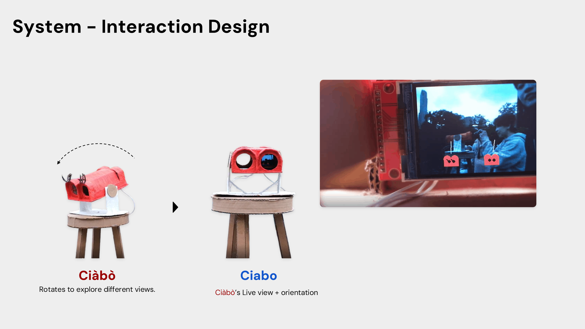

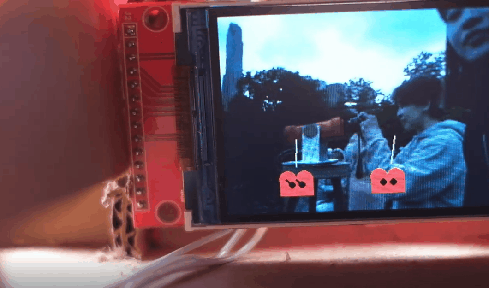

## Prototype and Field Test

The physical prototype combines the cardboard viewing body with the camera, display, sensors, and rotation structure.

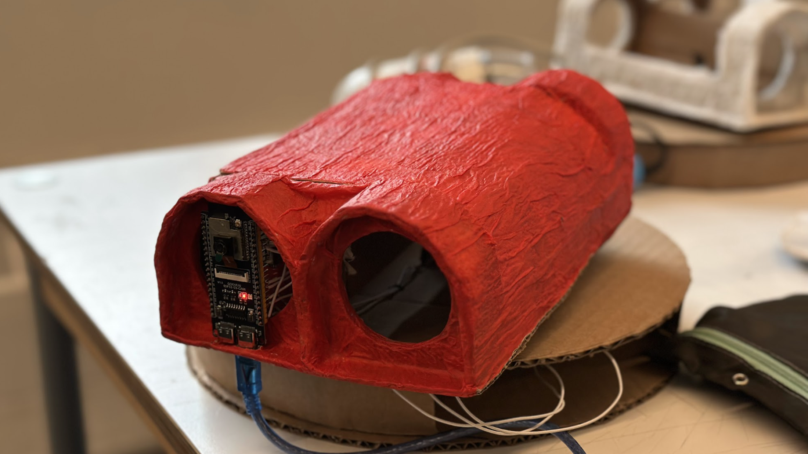

We installed the two binoculars at the Wollman Rink Overlook and observed how visitors approached and used them. The installation created opportunities for visitors to look through the devices, compare perspectives, and talk with nearby people.

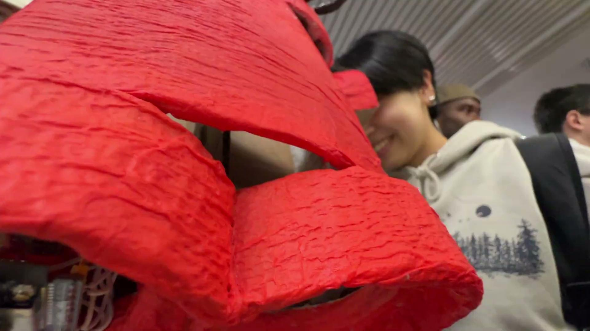

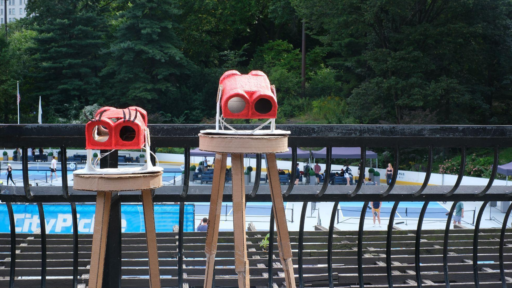

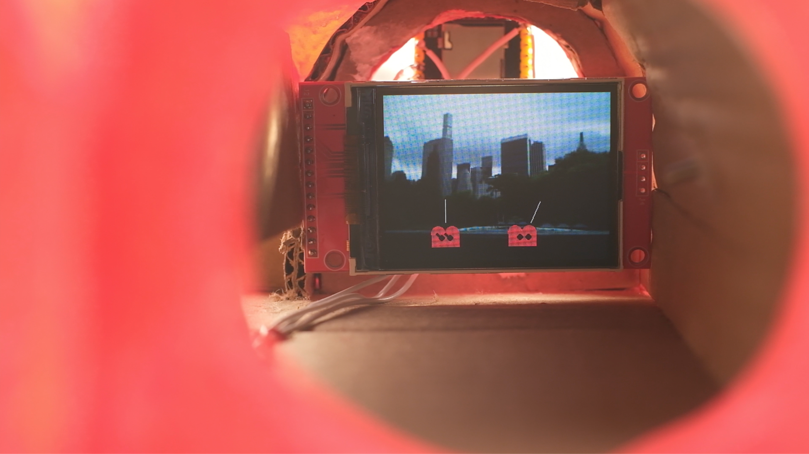

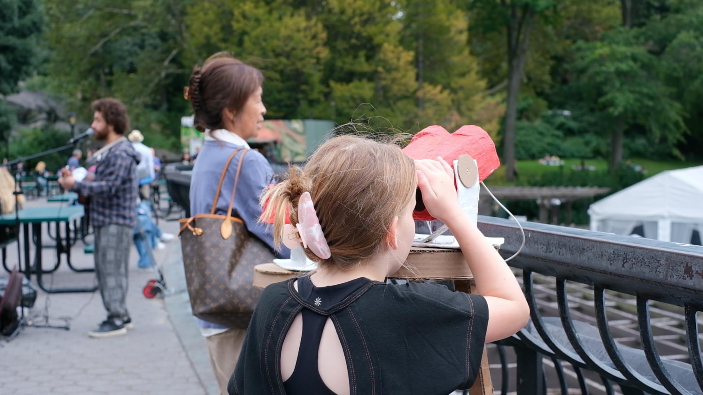

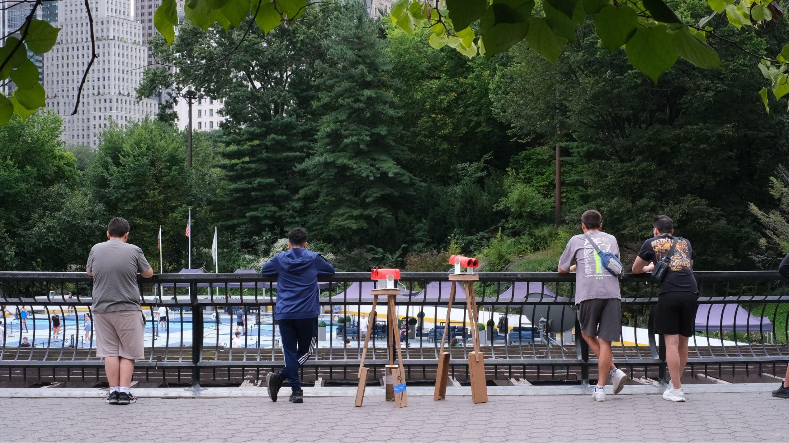

## Reflection

The direct interaction between two strangers was sometimes limited. However, the installation encouraged other forms of sharing. Visitors discussed the project in groups, introduced the experience to companions, passed it to the next person, and developed unexpected ways of using the objects.

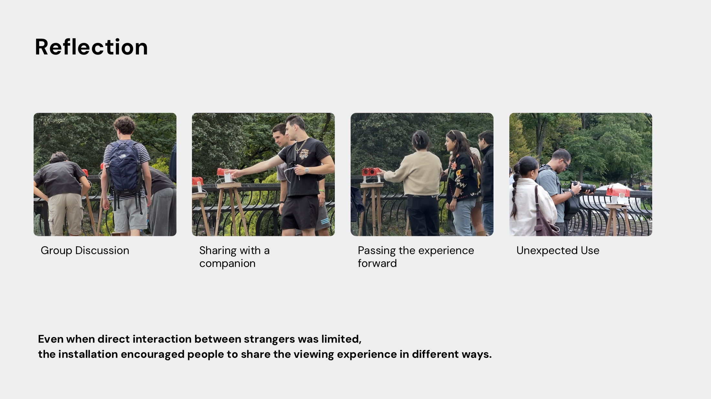

We also found that people were sometimes more willing to help or interact during transportation and assembly than during the planned installation. This suggests a future direction: the structure could become easier to carry and assemble, allowing strangers to participate before the formal interaction begins.

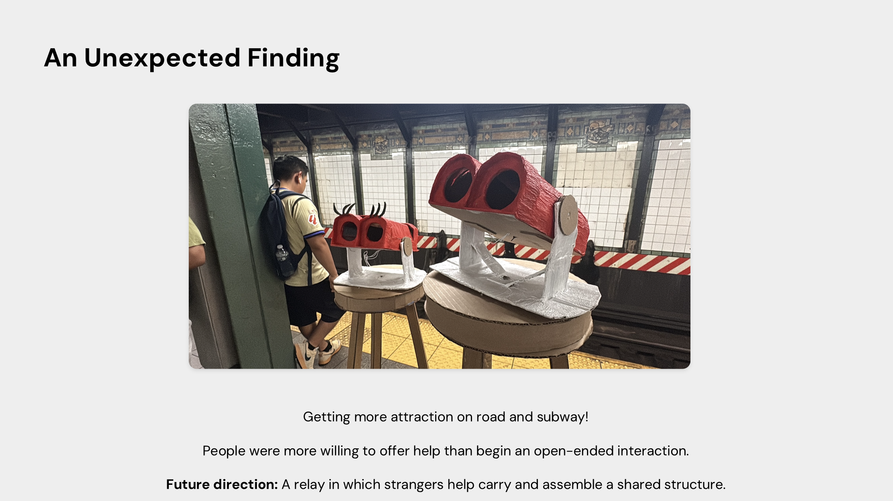
