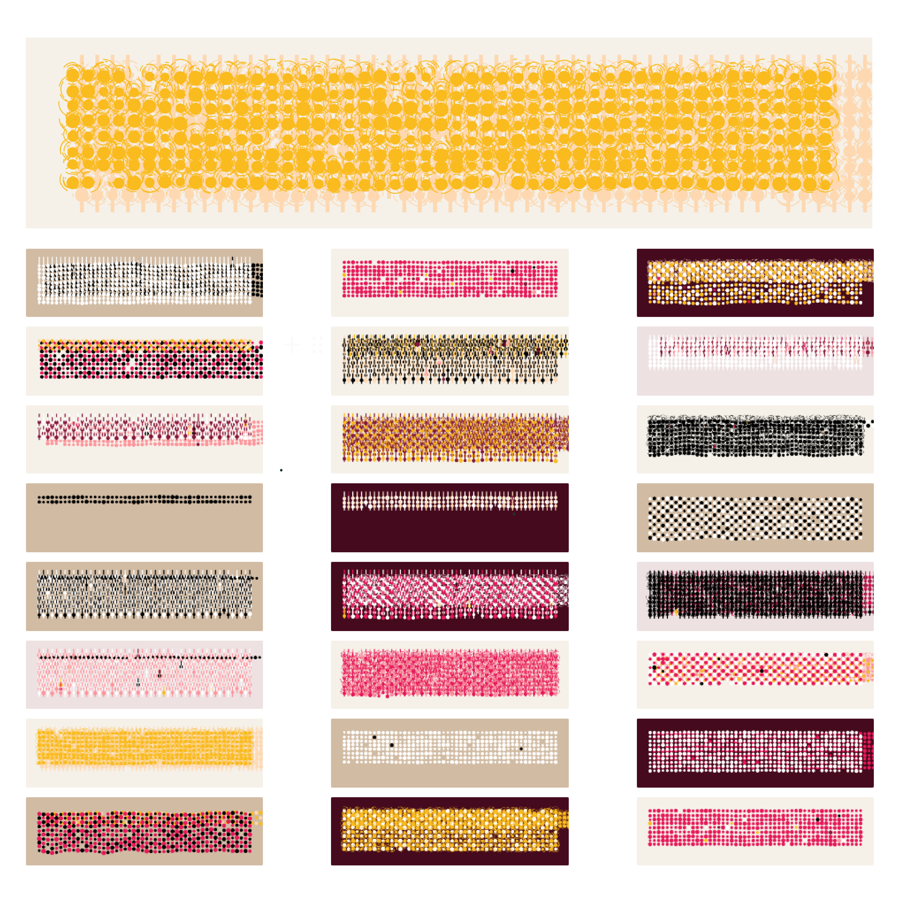

# The Back of Rug

*The Back of Rug* is a non-commercial generative art study made with p5.js and released on fxhash in 2023. It was created by following Tyler Hobbs's tutorial and is a tribute to his project *JACQUARD LEGACY*. Simple geometric shapes are stacked and tightly woven across the digital canvas. Small changes in the rules, colors, and spacing create many textures that resemble the hidden back of a rug. The work was offered for free and was not made as a commercial release.

《The Back of Rug》是一件以 p5.js 製作、並於 2023 年在 fxhash 上架的非商業生成藝術練習。作品依照 Tyler Hobbs 的教學進行，並向他的《JACQUARD LEGACY》致敬。簡單的幾何圖形在數位畫布上反覆堆疊、緊密交織，透過規則、色彩與間距的細微變化，形成如地毯背面般的紋理。作品以免費形式發布，並非商業販售。

> **Note:** The fxhash website was taken offline in 2026, so the original project page is no longer available.  
> **備註：** fxhash 網站已於 2026 年下架，因此原始作品頁面目前無法瀏覽。

<video
  controls
  playsinline
  preload="metadata"
  poster="/images/projects/the-back-of-rug/02-generative-rug-video-poster.webp"
  style="display: block; width: 100%; height: auto;"
>
  <source src="/images/projects/the-back-of-rug/02-generative-rug-video.mp4" type="video/mp4" />
  Your browser does not support the video tag.
</video>

<ImageGrid
  columns={2}
  aspect="1 / 1"
  images={[
    {
      src: "/images/projects/the-back-of-rug/03-blue-rug.png",
      alt: "A blue generative rug pattern made with dots and vertical lines",
    },
    {
      src: "/images/projects/the-back-of-rug/04-beige-rug.png",
      alt: "A beige generative rug pattern made with dense white and black marks",
    },
    {
      src: "/images/projects/the-back-of-rug/05-green-rug.png",
      alt: "A dark green generative rug pattern with yellow, blue, and white details",
    },
    {
      src: "/images/projects/the-back-of-rug/06-pink-rug.png",
      alt: "A pink generative rug pattern with red, yellow, white, and black details",
    },
  ]}
/>
